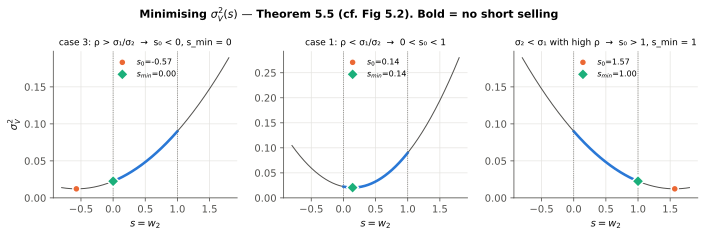
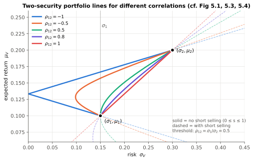
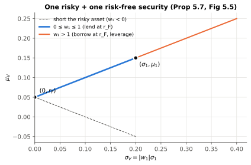
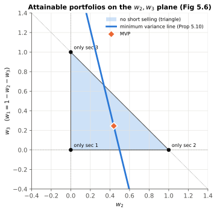
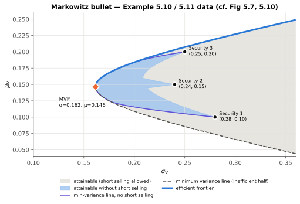
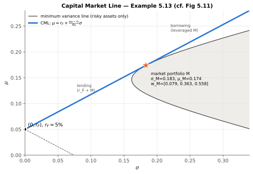
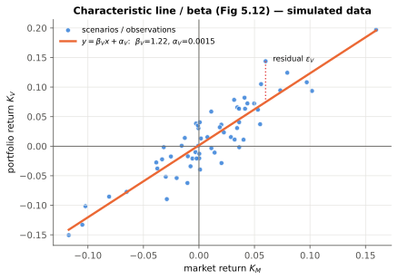
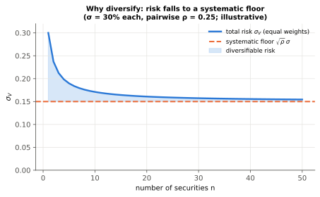
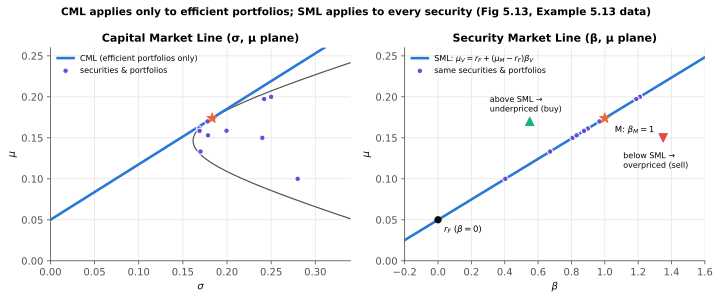

# Chapter 5: Portfolio Management
*Notes on Capiński & Zastawniak, **Mathematics for Finance: An Introduction to Financial Engineering**, Ch. 5 (pp. 91–124)*

By Claude Opus 5.5

---

## 0. Chapter map

```
5.1 Risk            → measure risk with Var(K) or σ_K
5.2 Two securities  → weights, μ_V, σ_V², the role of ρ₁₂, min-variance portfolio
5.3 n securities    → matrix form (m, C, w, u), MVP, min-variance line, efficient frontier
5.4 CAPM            → Capital Market Line, market portfolio, beta, Security Market Line
```


---

## 1. Notation cheat-sheet

| Symbol | Meaning |
|---|---|
| $K_i$ | (random) return on security $i$ over one period |
| $K_V$ | return on portfolio $V$ |
| $k$ | logarithmic return, $k=\ln(1+K)$ |
| $\mu_i = E(K_i)$, $\mu_V = E(K_V)$ | expected returns |
| $\sigma_i=\sqrt{\text{Var}(K_i)}$, $\sigma_V$ | standard deviations (risk) |
| $c_{ij}=\text{Cov}(K_i,K_j)$ | covariance; $c_{ii}=\sigma_i^2$ |
| $\rho_{12}=\dfrac{\text{Cov}(K_1,K_2)}{\sigma_1\sigma_2}$ | correlation coefficient, $-1\le\rho_{12}\le1$ |
| $x_i$ | **number of shares** of security $i$ held |
| $S_i(0)$, $S_i(1)$ | price of security $i$ at time 0 and 1 |
| $V(0)$, $V(1)$ | portfolio value at time 0 and 1 |
| $w_i$ | **weight** = share of initial wealth in security $i$ |
| $s$ | parameter for two-security portfolios: $s = w_2$, $w_1 = 1-s$ |
| $\boldsymbol{w}=[w_1\ \cdots\ w_n]$ | row vector of weights |
| $\boldsymbol{m}=[\mu_1\ \cdots\ \mu_n]$ | row vector of expected returns |
| $\boldsymbol{u}=[1\ \cdots\ 1]$ | row vector of ones |
| $\boldsymbol{C}=[c_{ij}]$ | $n\times n$ covariance matrix (symmetric, positive definite, assumed invertible) |
| $r_F$ | risk-free return |
| $M$, $\mu_M$, $\sigma_M$, $K_M$ | market portfolio and its expected return / risk / return |
| $\beta_V$, $\alpha_V$ | beta (slope) and alpha (intercept) of the characteristic line |
| $\varepsilon_V$ | residual random variable |

In this book **vectors are row vectors**. So $\boldsymbol{m}\boldsymbol{w}^T$ is a scalar (dot product), and $\boldsymbol{w}\boldsymbol{C}\boldsymbol{w}^T$ is a scalar (quadratic form).

---

## 2. Section 5.1: Risk

### 2.1 What should "risk" capture?
Two things:
1. **How far** the possible returns are from some reference value, and
2. **How likely** each scenario is.

The **spread** alone (max − min) is a poor measure because it ignores probabilities:
- 22% w.p. 0.99 and 2% w.p. 0.01 → spread is 20%, but risk is tiny.
- 22% and 2% with probability 0.5 each → same spread, much riskier.

So we use the expectation $E(K)$ as the reference value and measure dispersion around it.

> **Risk measures**
> $$\text{Var}(K)=E\big[(K-E(K))^2\big]=E(K^2)-E(K)^2,\qquad \sigma_K=\sqrt{\text{Var}(K)}$$

- $\sigma_K$ is in the **same units** as returns (%), which makes it easier to interpret. Variance is in squared units.

> **Scaling rule**
> $$\text{Var}(aK)=a^2\,\text{Var}(K),\qquad \sigma_{aK}=|a|\,\sigma_K$$

**In practice:** this is why leverage hurts so much. A 2× leveraged equity fund has 2× the volatility and **4×** the variance of the underlying index.

### 2.2 Remark 5.1: why ordinary returns, not log returns?
- Over **many time steps**, log returns add up: $k(0,n)=k(1)+\cdots+k(n)$. If the steps are independent:
$$\text{Var}(k(0,n))=\text{Var}(k(1))+\cdots+\text{Var}(k(n))$$
- In this chapter we hold **several securities over one step**. Ordinary returns combine **linearly** across securities (see 5.2), which is what we need. So the chapter uses $K$, not $k$.

---

## 3. Section 5.2: Two securities

### 3.1 Diversification in one example
Two stocks, two equally likely scenarios:

| Scenario | Prob | $K_1$ | $K_2$ |
|---|---|---|---|
| $\omega_1$ | 0.5 | 10% | −5% |
| $\omega_2$ | 0.5 | −5% | 10% |

Split 50/50 → you earn **5% in both scenarios**. The risk is **zero**, even though each stock on its own is risky. This works because the returns are **perfectly negatively correlated**.

**In practice:** an umbrella maker and an ice-cream maker. Each one's revenue depends on the weather, but owning both smooths out the weather risk. (Equity vs. gold in a crisis is a loose, imperfect version of the same idea.)

### 3.2 Weights

> **Weights** (book eq. for $w_1, w_2$ and (5.1))
> $$w_1=\frac{x_1S_1(0)}{V(0)},\qquad w_2=\frac{x_2S_2(0)}{V(0)},\qquad w_1+w_2=1 \tag{5.1}$$

- $w_k$ is the **fraction of the initial value** invested in security $k$.
- **Short selling** allowed → one weight can be **negative**, and the other is then **> 1**.
- Converting weights to share numbers: $x_i = w_i\,\dfrac{V(0)}{S_i(0)}$.

**Weights drift.** Weights are defined using **time-0 prices**. As prices move, the value split changes even if no shares are traded (Example 5.3: a 60/40 portfolio becomes 64.22/35.78).

### 3.3 Portfolio return

> **Proposition 5.1: portfolio return is the weighted average of the component returns**
> $$K_V = w_1K_1 + w_2K_2 \tag{5.2}$$

*Proof idea:* $V(1)=x_1S_1(0)(1+K_1)+x_2S_2(0)(1+K_2)=V(0)\big(w_1(1+K_1)+w_2(1+K_2)\big)$. Then divide by $V(0)$ and subtract 1.

> **Remark 5.2: the log-return version is *not* linear**
> $$e^{k_V}=w_1e^{k_1}+w_2e^{k_2} \tag{5.3}$$

### 3.4 Expected return and variance of a two-asset portfolio

> **Expected return** (linearity of $E$)
> $$E(K_V)=w_1E(K_1)+w_2E(K_2) \tag{5.4}$$

> **Theorem 5.2: portfolio variance**
> $$\text{Var}(K_V)=w_1^2\text{Var}(K_1)+w_2^2\text{Var}(K_2)+2w_1w_2\,\text{Cov}(K_1,K_2) \tag{5.5}$$

The same two formulas in compact notation:

> **The two workhorse formulas**
> $$\mu_V=w_1\mu_1+w_2\mu_2 \tag{5.7}$$
> $$\sigma_V^2=w_1^2\sigma_1^2+w_2^2\sigma_2^2+2w_1w_2\,\rho_{12}\,\sigma_1\sigma_2 \tag{5.8}$$

- $\mu_V$ is **linear** in the weights. $\sigma_V^2$ is **quadratic** in them.
- The cross term $2w_1w_2\rho_{12}\sigma_1\sigma_2$ is where diversification comes from. When $\rho_{12}<1$, the portfolio's $\sigma_V$ is **less** than the weighted average $w_1\sigma_1+w_2\sigma_2$ (for long-only weights).

**Illustration (Example 5.6 data):**

| Scenario | Prob | $K_1$ | $K_2$ |
|---|---|---|---|
| recession | 0.4 | −10% | 20% |
| stagnation | 0.2 | 0% | 20% |
| boom | 0.4 | 20% | 10% |

$\sigma_1^2\approx0.0184$, $\sigma_2^2\approx0.0024$, $\rho_{12}\approx-0.96309$.

| Weights $(w_1,w_2)$ | $\sigma_V^2$ | Compared with components |
|---|---|---|
| (40%, 60%) | 0.000736 | **smaller than both**: diversification |
| (80%, 20%) | 0.009824 | between the two |
| (−50%, 150%) | 0.0196 | **larger than both**: shorting adds risk |

> **Proposition 5.3: with no short selling, the portfolio is never riskier than its riskiest component**
> $$\sigma_V^2\le\max\{\sigma_1^2,\sigma_2^2\}\quad(\text{if }w_1,w_2\ge0)$$
> *Proof idea:* $\rho_{12}\le1 \Rightarrow \sigma_V^2\le(w_1\sigma_1+w_2\sigma_2)^2\le\max(\sigma_1,\sigma_2)^2$.

### 3.5 The extreme cases $\rho_{12}=\pm1$: risk can be eliminated

> **Proposition 5.4: zero-risk portfolios**
>
> **If $\rho_{12}=1$** (and $\sigma_1\ne\sigma_2$): $\sigma_V=0$ for
> $$w_1=-\frac{\sigma_2}{\sigma_1-\sigma_2},\qquad w_2=\frac{\sigma_1}{\sigma_1-\sigma_2} \tag{5.9}$$
> This **requires short selling** (one weight is negative).
>
> **If $\rho_{12}=-1$**: $\sigma_V=0$ for
> $$w_1=\frac{\sigma_2}{\sigma_1+\sigma_2},\qquad w_2=\frac{\sigma_1}{\sigma_1+\sigma_2} \tag{5.10}$$
> **No short selling needed** (both weights are positive).

*Why:* with $\rho=\pm1$, (5.8) becomes a perfect square, $\sigma_V^2=(w_1\sigma_1\pm w_2\sigma_2)^2$, so $\sigma_V=|w_1\sigma_1\pm w_2\sigma_2|$, which you can set to zero.

**In practice:** $\rho=+1$ with shorting is the logic behind a **hedge**. Example: long a stock and short the right amount of its futures. Both move together, so the shorted position cancels the risk.

**Parametric form ($s=w_2$, $w_1=1-s$):**

$$\rho_{12}=-1:\quad \sigma_V=|(1-s)\sigma_1-s\sigma_2|,\qquad \mu_V=(1-s)\mu_1+s\mu_2$$
$$\rho_{12}=+1:\quad \sigma_V=|(1-s)\sigma_1+s\sigma_2|,\qquad \mu_V=(1-s)\mu_1+s\mu_2$$

On the $(\sigma,\mu)$ plane: for $\rho=-1$ the line **bends to touch the $\mu$-axis**. For $\rho=+1$ it is a **straight segment** between the two securities. $0\le s\le1$ means no short selling.

### 3.6 General $\rho_{12}$: the portfolio line and the minimum-variance portfolio

> **Two-security portfolio line in terms of $s=w_2$**
> $$\mu_V=(1-s)\mu_1+s\mu_2 \tag{5.11}$$
> $$\sigma_V^2=(1-s)^2\sigma_1^2+s^2\sigma_2^2+2s(1-s)\rho_{12}\sigma_1\sigma_2 \tag{5.12}$$

$\sigma_V^2$ is a parabola in $s$, opening upward (its $s^2$-coefficient is $\sigma_1^2+\sigma_2^2-2\rho_{12}\sigma_1\sigma_2>(\sigma_1-\sigma_2)^2\ge0$).

> **Theorem 5.5: minimum-variance weight** (for $-1<\rho_{12}<1$)
> $$s_0=\frac{\sigma_1^2-\rho_{12}\sigma_1\sigma_2}{\sigma_1^2+\sigma_2^2-2\rho_{12}\sigma_1\sigma_2} \tag{5.13}$$
> **With no short selling**, clip $s_0$ to $[0,1]$:
> $$s_{\min}=\begin{cases}0 & s_0<0\\ s_0 & 0\le s_0\le1\\ 1 & s_0>1\end{cases}$$

*Proof:* set $d\sigma_V^2/ds=0$. The second derivative is $>0$, so this is a global minimum.



*Figure A (cf. book Fig 5.2). Bold segment = $0\le s\le1$. Orange dot = unconstrained minimum $s_0$; green diamond = minimum without short selling.*



*Figure B (cf. Figs 5.1, 5.3, 5.4). Illustrative data: $\mu_1=10\%,\sigma_1=15\%$, $\mu_2=20\%,\sigma_2=30\%$. The lower the correlation, the further the curve bulges to the left (less risk). Here the threshold is $\sigma_1/\sigma_2=0.5$.*

> **Corollary 5.6: when can you beat the less risky asset?** (assume $\sigma_1\le\sigma_2$)
>
> | Condition | Result |
> |---|---|
> | $-1\le\rho_{12}<\dfrac{\sigma_1}{\sigma_2}$ | there is a portfolio **without** short selling with $\sigma_V<\sigma_1$ |
> | $\rho_{12}=\dfrac{\sigma_1}{\sigma_2}$ | $\sigma_V\ge\sigma_1$ for **every** portfolio ($s_0=0$) |
> | $\dfrac{\sigma_1}{\sigma_2}<\rho_{12}\le1$ | $\sigma_V<\sigma_1$ is possible **only with** short selling (short security 1) |

**Common mistake:** students often assume "diversification always lowers risk below the safer asset." It does so only when $\rho_{12}<\sigma_1/\sigma_2$. In Figure B, the $\rho=0.8$ (violet) solid segment never goes left of $\sigma_1$.

### 3.7 One risky + one risk-free security

> **Proposition 5.7**
> If security 2 is risk-free ($\sigma_2=0$, return $r_F$):
> $$\sigma_V=|w_1|\,\sigma_1,\qquad \mu_V=r_F+w_1(\mu_1-r_F)$$

On the $(\sigma,\mu)$ plane this is **two straight half-lines** starting at $(0,r_F)$.



*Figure C (cf. Fig 5.5). Illustrative: $r_F=5\%$, $\mu_1=15\%$, $\sigma_1=20\%$.*

**In practice:** splitting money between a liquid/T-bill fund (≈ risk-free) and an equity index fund. Every split lies on the blue segment. Borrowing to buy more equity (margin) takes you onto the orange part.

---

## 4. Section 5.3: Several securities

### 4.1 Matrix set-up

$$w_i=\frac{x_iS_i(0)}{V(0)},\quad \boldsymbol{w}=[w_1\cdots w_n],\quad \boldsymbol{m}=[\mu_1\cdots\mu_n],\quad \boldsymbol{u}=[1\cdots1],\quad \boldsymbol{C}=[c_{ij}]$$

> **Budget constraint**
> $$\boldsymbol{u}\boldsymbol{w}^T=1 \tag{5.14}$$
> Portfolios that satisfy (5.14) form the **attainable set**.

> **Proposition 5.8: portfolio mean and variance in matrix form**
> $$\mu_V=\boldsymbol{m}\boldsymbol{w}^T \tag{5.15}$$
> $$\sigma_V^2=\boldsymbol{w}\boldsymbol{C}\boldsymbol{w}^T=\sum_{i,j=1}^n w_iw_jc_{ij} \tag{5.16}$$

With $n=2$ these reduce exactly to (5.7) and (5.8). Build $\boldsymbol C$ from $c_{ij}=\rho_{ij}\sigma_i\sigma_j$.

### 4.2 The two optimisation problems
1. **Minimum variance portfolio (MVP):** the smallest $\sigma_V^2$ over the whole attainable set.
2. **Minimum variance line:** for each target $\mu_V$, the smallest $\sigma_V^2$ among portfolios with that expected return.

Both are solved with **Lagrange multipliers**.

> **Proposition 5.9: Minimum Variance Portfolio**
> $$\boldsymbol{w}_{MVP}=\frac{\boldsymbol{u}\boldsymbol{C}^{-1}}{\boldsymbol{u}\boldsymbol{C}^{-1}\boldsymbol{u}^T}$$

*Proof sketch:* $F=\boldsymbol w\boldsymbol C\boldsymbol w^T-\lambda\boldsymbol u\boldsymbol w^T$. Setting $\partial F/\partial w_i=0$ gives $2\boldsymbol w\boldsymbol C=\lambda\boldsymbol u$, so $\boldsymbol w=\tfrac{\lambda}{2}\boldsymbol u\boldsymbol C^{-1}$. Choose $\lambda$ so that $\boldsymbol u\boldsymbol w^T=1$.

> **Proposition 5.10: Minimum Variance Line**
> $$\boldsymbol w=\frac{\begin{vmatrix}1 & \boldsymbol u\boldsymbol C^{-1}\boldsymbol m^T\\ \mu_V & \boldsymbol m\boldsymbol C^{-1}\boldsymbol m^T\end{vmatrix}\boldsymbol u\boldsymbol C^{-1}+\begin{vmatrix}\boldsymbol u\boldsymbol C^{-1}\boldsymbol u^T & 1\\ \boldsymbol m\boldsymbol C^{-1}\boldsymbol u^T & \mu_V\end{vmatrix}\boldsymbol m\boldsymbol C^{-1}}{\begin{vmatrix}\boldsymbol u\boldsymbol C^{-1}\boldsymbol u^T & \boldsymbol u\boldsymbol C^{-1}\boldsymbol m^T\\ \boldsymbol m\boldsymbol C^{-1}\boldsymbol u^T & \boldsymbol m\boldsymbol C^{-1}\boldsymbol m^T\end{vmatrix}}$$
> The weights are **linear in $\mu_V$**: $\boldsymbol w=\boldsymbol a\,\mu_V+\boldsymbol b$.

**Easier version to memorise.** Let
$$A=\boldsymbol u\boldsymbol C^{-1}\boldsymbol u^T,\quad B=\boldsymbol u\boldsymbol C^{-1}\boldsymbol m^T=\boldsymbol m\boldsymbol C^{-1}\boldsymbol u^T,\quad D=\boldsymbol m\boldsymbol C^{-1}\boldsymbol m^T,\quad \Delta=AD-B^2.$$
Then
$$\boxed{\ \boldsymbol w=\frac{(D-B\mu_V)\,\boldsymbol u\boldsymbol C^{-1}+(A\mu_V-B)\,\boldsymbol m\boldsymbol C^{-1}}{\Delta}\ },\qquad \boxed{\ \sigma_V^2=\frac{A\mu_V^2-2B\mu_V+D}{\Delta}\ }$$
The second formula shows the minimum variance line is a **hyperbola** on the $(\sigma,\mu)$ plane. Its vertex is the MVP, at $\mu_{MVP}=B/A$ and $\sigma^2_{MVP}=1/A$.
*(This is the same result as Prop 5.10, written with letters for the scalars. It is not printed this way in the book.)*

*Proof sketch:* $G=\boldsymbol w\boldsymbol C\boldsymbol w^T-\lambda\boldsymbol u\boldsymbol w^T-\mu\boldsymbol m\boldsymbol w^T$ gives $\boldsymbol w=\tfrac\lambda2\boldsymbol u\boldsymbol C^{-1}+\tfrac\mu2\boldsymbol m\boldsymbol C^{-1}$. Substituting into both constraints gives a 2×2 linear system in $\lambda,\mu$; solve it with Cramer's rule.

#### Example 5.10 (three securities): the main worked example

| $i$ | $\mu_i$ | $\sigma_i$ | correlations |
|---|---|---|---|
| 1 | 0.10 | 0.28 | $\rho_{12}=-0.10$ |
| 2 | 0.15 | 0.24 | $\rho_{23}=0.20$ |
| 3 | 0.20 | 0.25 | $\rho_{31}=0.25$ |

$$\boldsymbol C\approx\begin{bmatrix}0.0784&-0.0067&0.0175\\-0.0067&0.0576&0.0120\\0.0175&0.0120&0.0625\end{bmatrix},\quad \boldsymbol C^{-1}\approx\begin{bmatrix}13.954&2.544&-4.396\\2.544&18.548&-4.274\\-4.396&-4.274&18.051\end{bmatrix}$$

- $\boldsymbol u\boldsymbol C^{-1}\approx[12.102\ \ 16.818\ \ 9.382]$, $A\approx38.302$
- $\boldsymbol m\boldsymbol C^{-1}\approx[0.898\ \ 2.182\ \ 2.530]$, $D\approx0.923$, $B\approx5.609$
- **MVP:** $\boldsymbol w\approx[0.316\ \ 0.439\ \ 0.245]$, $\mu_V\approx0.146$, $\sigma_V\approx0.162$
- **Min-variance line:** $\boldsymbol w\approx[1.578-8.614\mu_V,\ \ 0.845-2.769\mu_V,\ \ -1.422+11.384\mu_V]$
- $\sigma_V\approx\sqrt{0.237-2.885\mu_V+9.850\mu_V^2}$

(I re-ran all of these numbers in Python and they match the book.)

### 4.3 Visualising the attainable set (Examples 5.11, 5.12)

**Picture 1: the weight plane ($w_2,w_3$; $w_1=1-w_2-w_3$).**
- The vertices of the triangle are single-security portfolios. The edges are two-security portfolios.
- **Inside the triangle** = no short selling. Outside = at least one security is shorted.
- The min-variance line is a **straight line** here, because the weights are linear in $\mu_V$.



*Figure D (cf. Fig 5.6), Example 5.10 data.*

**Picture 2: the risk–expected return plane, i.e. the Markowitz bullet.**
- The whole attainable set (with shorting) is the region to the **right** of the min-variance hyperbola: the **Markowitz bullet**.
- The weight plane gets *folded* along the min-variance line onto this region. So each interior point of the bullet corresponds to **two** portfolios, and each boundary point to exactly one.
- **Without short selling** (Example 5.12) the region shrinks to the blue area. Its boundary is made of pieces of the two-security curves.



*Figure E (cf. Figs 5.7, 5.8, 5.10). Grey = attainable with short selling; blue = without. The no-short-selling regions are computed exactly, not sketched.*

### 4.4 Efficient frontier (§5.3.2)

> **Definition 5.1: dominance.** Security/portfolio 1 **dominates** 2 if
> $$\mu_1\ge\mu_2\quad\text{and}\quad\sigma_1\le\sigma_2$$

> **Definition 5.2: efficient portfolio / efficient frontier.** A portfolio is **efficient** if no other portfolio dominates it. The set of efficient portfolios is the **efficient frontier**.

Key facts:
- The efficient frontier is a **subset of the min-variance line**: the **upper half**, starting at the MVP ($\mu_V\ge\mu_{MVP}$). This is the blue curve in Figure E.
- Remark 5.4: a **dominated** security is not useless. Combined with the dominating one, it can **reduce risk** below either of them (Fig 5.9).
- Which efficient portfolio to pick depends on the investor's **risk appetite**. Theory says only: *pick something on the frontier.*

> **Proposition 5.11: two-fund theorem.** If $\boldsymbol w'$ and $\boldsymbol w''$ are any two different portfolios on the min-variance line, then the whole line is
> $$\{\,c\boldsymbol w'+(1-c)\boldsymbol w''\;:\;c\in\mathbb R\,\}$$

**Why it matters:** however many securities there are, the min-variance line has the **same shape as a two-security line**. Any two frontier "funds" can replicate every other frontier portfolio.

> **Proposition 5.12: tangency condition.** Every efficient portfolio (other than the MVP) satisfies
> $$\gamma\,\boldsymbol w\boldsymbol C=\boldsymbol m-\mu\,\boldsymbol u \tag{5.17}$$
> for some $\gamma>0$ and real $\mu$.
> **Interpretation (Remark 5.5):** $\mu$ = **intercept** on the $\mu$-axis of the tangent line to the frontier at that portfolio; $\gamma\sigma_V$ = its **slope**.

*Proof idea:* the tangent line through $(0,\mu)$ has the **maximal slope** $\dfrac{\boldsymbol m\boldsymbol w^T-\mu}{\sqrt{\boldsymbol w\boldsymbol C\boldsymbol w^T}}$ among lines from $(0,\mu)$ that touch the attainable set. Maximise this subject to $\boldsymbol u\boldsymbol w^T=1$ and you get (5.17) with $\gamma=(\mu_V-\mu)/\sigma_V^2$.

This slope is a **Sharpe ratio** (with $\mu$ playing the role of $r_F$). So Prop 5.12 is the maths behind "the tangency portfolio maximises the Sharpe ratio."

---

## 5. Section 5.4: Capital Asset Pricing Model (CAPM)

**Motivation:** with $n=1000$ securities, $\boldsymbol C$ has $10^6$ entries. Estimating and inverting it is hard. CAPM gives a simpler structure.

**Assumption:** all investors use the **same** $\mu_i$, $\sigma_i$, $\rho_{ij}$, so everyone computes the **same efficient frontier**. They differ only in risk appetite.

### 5.1 Capital Market Line (CML)
- Add a risk-free asset with return $r_F$. Combining $r_F$ with any risky portfolio gives straight half-lines from $(0,r_F)$ (Prop 5.7).
- The new efficient frontier is the half-line from $(0,r_F)$ that is **tangent to the Markowitz bullet**. This is the **Capital Market Line**.
- The tangency point $(\sigma_M,\mu_M)$ is the **market portfolio** $M$. Every investor holds risky assets in the **same proportions** as $M$, so $M$ must contain every risky security in proportion to its share of total market value.
- The argument needs $r_F$ to be not too high (below $\mu_{MVP}$), so that a tangent exists.

> **Capital Market Line**
> $$\mu=r_F+\frac{\mu_M-r_F}{\sigma_M}\,\sigma \tag{5.18}$$
> **Risk premium** (on the CML) $=\dfrac{\mu_M-r_F}{\sigma_M}\,\sigma$.
> The slope $\dfrac{\mu_M-r_F}{\sigma_M}$ is the **market price of risk** (the market's Sharpe ratio).

> **Computing the market portfolio (Example 5.13)**
> From (5.17) with $\mu=r_F$:
> $$\gamma\boldsymbol w_M=(\boldsymbol m-r_F\boldsymbol u)\boldsymbol C^{-1},\qquad \text{then normalise so that }\boldsymbol u\boldsymbol w_M^T=1$$

**Example 5.13** (Example 5.10 data, $r_F=5\%$): $\gamma\boldsymbol w\approx[0.293\ \ 1.341\ \ 2.061]$, so $\gamma\approx3.694$ and
$$\boldsymbol w_M\approx[0.079\ \ 0.363\ \ 0.558]$$
(The book doesn't print these, but my code gives $\mu_M\approx0.174$ and $\sigma_M\approx0.183$.)



*Figure F (cf. Fig 5.11).*

**In practice:** this is the theory behind **index investing**. The market portfolio is approximated by a broad index (e.g. Nifty 50 / Nifty 500 in India, S&P 500 in the US). A conservative investor holds some index fund plus liquid/G-sec funds (lending part of the CML). An aggressive one leverages the index (borrowing part).

### 5.2 Beta factor
Plot $K_V$ against $K_M$ across scenarios and fit the **line of best fit** (regression / **characteristic line**):
$$y=\beta_Vx+\alpha_V$$
Residual: $\varepsilon_V=K_V-(\alpha_V+\beta_VK_M)$. Minimise $E(\varepsilon^2)$ over $\alpha,\beta$. That gives the normal equations
$$\alpha_VE(K_M)+\beta_VE(K_M^2)=E(K_VK_M),\qquad \alpha_V+\beta_VE(K_M)=E(K_V).$$

> **Beta and alpha** (Definition 5.3)
> $$\beta_V=\frac{\text{Cov}(K_V,K_M)}{\sigma_M^2},\qquad \alpha_V=\mu_V-\beta_V\mu_M$$

> **Risk decomposition**
> $$\sigma_V^2=\underbrace{\text{Var}(\varepsilon_V)}_{\text{residual / diversifiable}}+\underbrace{\beta_V^2\sigma_M^2}_{\text{systematic / undiversifiable}}$$

- **Diversifiable (residual) risk** can be removed by diversifying. For the market itself, $\text{Var}(\varepsilon_M)=0$.
- **Systematic risk** ($\propto\beta_V^2$) **cannot** be diversified away. In CAPM, **only systematic risk earns a premium.**
- $\beta>0$ → tends to move with the market. $\beta<0$ → tends to move against it.
- **Beta is linear in weights**: $\beta_V=w_1\beta_1+\cdots+w_n\beta_n$. Also $\beta_M=1$ and $\beta_F=0$.



*Figure G (cf. Fig 5.12). Simulated monthly returns with true $\beta=1.3$. The fitted $\beta$ differs because of noise, which is the estimation problem you meet in practice.*



*Figure H (illustrative, **beyond the book**): an equal-weighted portfolio of $n$ securities, each with $\sigma=30\%$ and pairwise $\rho=0.25$. Then $\sigma_V^2=\sigma^2/n+(1-1/n)\rho\sigma^2$. The diversifiable part goes to zero as $n$ grows; the systematic floor $\sqrt\rho\,\sigma$ stays.*

**In practice:** this is why 20–30 well-spread stocks capture most of the diversification benefit, and why a stock's **beta** (not its total volatility) drives its cost of equity in a DCF / WACC.

### 5.3 Security Market Line (SML)
Start from $\gamma\boldsymbol w_M\boldsymbol C=\boldsymbol m-\mu\boldsymbol u$. For any portfolio $\boldsymbol w_V$:
$$\beta_V=\frac{\boldsymbol w_M\boldsymbol C\boldsymbol w_V^T}{\boldsymbol w_M\boldsymbol C\boldsymbol w_M^T}=\frac{\mu_V-\mu}{\mu_M-\mu}.$$
Plugging in the risk-free asset ($\beta_F=0$, return $r_F$) shows $\mu=r_F$.

> **Theorem 5.13: Security Market Line (the CAPM equation)**
> $$\mu_V=r_F+(\mu_M-r_F)\,\beta_V \tag{5.19}$$
> **Risk premium** $=(\mu_M-r_F)\beta_V$: compensation for **systematic** risk only.

| | CML (5.18) | SML (5.19) |
|---|---|---|
| Axes | $(\sigma,\mu)$ | $(\beta,\mu)$ |
| Risk measure | total risk $\sigma$ | systematic risk $\beta$ |
| Applies to | **efficient** portfolios only | **every** security and portfolio |
| Slope | $(\mu_M-r_F)/\sigma_M$ | $\mu_M-r_F$ |
| Passes through | $(0,r_F)$ and $(\sigma_M,\mu_M)$ | $(0,r_F)$ and $(1,\mu_M)$ |



*Figure I (cf. Fig 5.13). The same securities and portfolios: scattered **inside** the bullet on the left, all **on** the SML on the right.*

### 5.4 Equilibrium and mispricing
- In equilibrium everyone holds $M$ (plus borrowing or lending), so supply equals demand.
- If new information gives
  - $\mu_V>r_F+(\mu_M-r_F)\beta_V$ (**above SML**): the security is **underpriced**. Investors buy, the price rises, and $\mu_V$ falls back to the line.
  - $\mu_V<r_F+(\mu_M-r_F)\beta_V$ (**below SML**): the security is **overpriced**. Investors sell, the price falls, and $\mu_V$ rises.

In practice the gap $\mu_V-[r_F+(\mu_M-r_F)\beta_V]$ is **Jensen's alpha**, used to judge whether a fund manager added value. (That is related to, but not the same as, the regression intercept $\alpha_V$ above.)

**Common point of characteristic lines:** under CAPM, $\alpha_V=\mu_V-\beta_V\mu_M=r_F(1-\beta_V)$. So every characteristic line $y=r_F+\beta_V(x-r_F)$ passes through the **common point $(r_F,r_F)$**.

---

## 6. One-page formula sheet

| # | Formula | Where |
|---|---|---|
| 1 | $\text{Var}(aK)=a^2\text{Var}(K)$, $\sigma_{aK}=\lvert a\rvert\sigma_K$ | §5.1 |
| 2 | $w_i=x_iS_i(0)/V(0)$, $\sum w_i=1$ | (5.1), (5.14) |
| 3 | $K_V=\sum w_iK_i$ | (5.2) |
| 4 | $e^{k_V}=\sum w_ie^{k_i}$ | (5.3) |
| 5 | $\mu_V=w_1\mu_1+w_2\mu_2$ | (5.7) |
| 6 | $\sigma_V^2=w_1^2\sigma_1^2+w_2^2\sigma_2^2+2w_1w_2\rho_{12}\sigma_1\sigma_2$ | (5.8) |
| 7 | $\rho=1$: $w_1=-\frac{\sigma_2}{\sigma_1-\sigma_2}$; $\rho=-1$: $w_1=\frac{\sigma_2}{\sigma_1+\sigma_2}$ (zero risk) | (5.9), (5.10) |
| 8 | $s_0=\dfrac{\sigma_1^2-\rho\sigma_1\sigma_2}{\sigma_1^2+\sigma_2^2-2\rho\sigma_1\sigma_2}$, $s=w_2$ | (5.13) |
| 9 | Risk-free mix: $\sigma_V=\lvert w_1\rvert\sigma_1$ | Prop 5.7 |
| 10 | $\mu_V=\boldsymbol m\boldsymbol w^T$, $\sigma_V^2=\boldsymbol w\boldsymbol C\boldsymbol w^T$ | (5.15), (5.16) |
| 11 | MVP: $\boldsymbol w=\dfrac{\boldsymbol u\boldsymbol C^{-1}}{\boldsymbol u\boldsymbol C^{-1}\boldsymbol u^T}$ | Prop 5.9 |
| 12 | Min-var line: $\boldsymbol w=\dfrac{(D-B\mu_V)\boldsymbol u\boldsymbol C^{-1}+(A\mu_V-B)\boldsymbol m\boldsymbol C^{-1}}{AD-B^2}$ | Prop 5.10 |
| 13 | $\sigma_V^2=\dfrac{A\mu_V^2-2B\mu_V+D}{AD-B^2}$ | from Prop 5.10 |
| 14 | Efficient portfolio: $\gamma\boldsymbol w\boldsymbol C=\boldsymbol m-\mu\boldsymbol u$, $\gamma>0$ | (5.17) |
| 15 | Market portfolio: $\boldsymbol w_M\propto(\boldsymbol m-r_F\boldsymbol u)\boldsymbol C^{-1}$, normalised | §5.4.1 |
| 16 | CML: $\mu=r_F+\dfrac{\mu_M-r_F}{\sigma_M}\sigma$ | (5.18) |
| 17 | $\beta_V=\dfrac{\text{Cov}(K_V,K_M)}{\sigma_M^2}$, $\alpha_V=\mu_V-\beta_V\mu_M$ | Def 5.3 |
| 18 | $\sigma_V^2=\text{Var}(\varepsilon_V)+\beta_V^2\sigma_M^2$ | §5.4.2 |
| 19 | $\beta_V=\sum w_i\beta_i$ | §5.4.2 |
| 20 | SML: $\mu_V=r_F+(\mu_M-r_F)\beta_V$ | (5.19) |

where $A=\boldsymbol u\boldsymbol C^{-1}\boldsymbol u^T$, $B=\boldsymbol u\boldsymbol C^{-1}\boldsymbol m^T$, $D=\boldsymbol m\boldsymbol C^{-1}\boldsymbol m^T$.

---

## 7. Common mistakes and quick checks
1. **Weights must sum to 1**, and they can be negative when shorting is allowed. Always check $\boldsymbol u\boldsymbol w^T=1$ in your final answer.
2. **Covariance from correlation:** $c_{ij}=\rho_{ij}\sigma_i\sigma_j$. Don't put $\rho$ directly into $\boldsymbol C$.
3. If the problem gives **variances**, take square roots before using $\rho\sigma_1\sigma_2$.
4. **"No short selling"** → clip $s_0$ to $[0,1]$ (Theorem 5.5). With $n\ge3$, the long-only frontier is **not** given by Prop 5.10; it needs constrained optimisation.
5. **The efficient frontier is only the upper half** of the min-variance line.
6. **CML vs SML:** use $\sigma$ on the CML (efficient portfolios only) and $\beta$ on the SML (anything).
7. Sanity checks: $\beta_M=1$, $\beta_F=0$, $\sigma^2_{MVP}=1/A$, $\mu_{MVP}=B/A$.
8. When you apply Corollary 5.6, label the securities so that $\sigma_1\le\sigma_2$ first.

---

