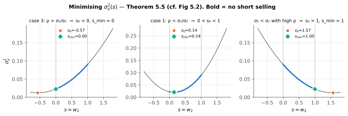
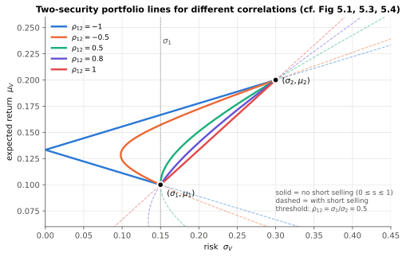
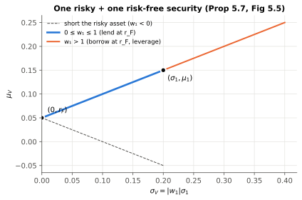
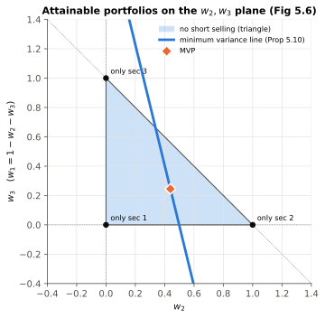
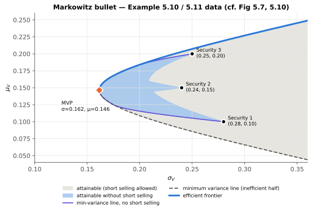
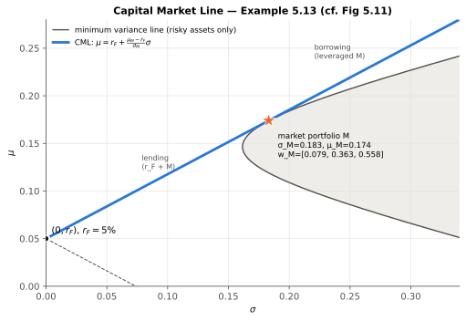
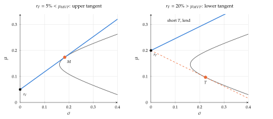
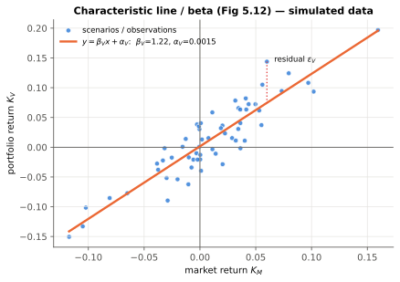
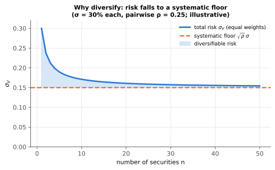
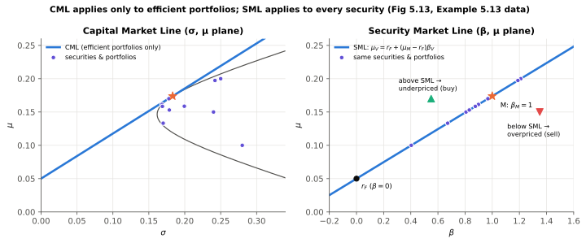

# Chapter 5: Portfolio Management
*Notes on Capiński & Zastawniak, **Mathematics for Finance: An Introduction to Financial Engineering**, Ch. 5 (pp. 91–124)*

By Claude Opus 5.5

---

## 0. Chapter map

```
5.1 Risk            → measure risk with Var(K) or σ_K
5.2 Two securities  → weights, μ_V, σ_V², the role of ρ₁₂, min-variance portfolio
5.3 n securities    → matrix form (m, C, w, u), MVP, min-variance line, efficient frontier
5.4 CAPM            → Capital Market Line, market portfolio, beta, Security Market Line
+   Beyond the book → estimation error, empirical record of CAPM, extensions, further reading
```


---

## 1. Notation cheat-sheet

| Symbol | Meaning |
|---|---|
| $K_i$ | (random) return on security $i$ over one period |
| $K_V$ | return on portfolio $V$ |
| $k$ | logarithmic return, $k=\ln(1+K)$ |
| $\mu_i = E(K_i)$, $\mu_V = E(K_V)$ | expected returns |
| $\sigma_i=\sqrt{\text{Var}(K_i)}$, $\sigma_V$ | standard deviations (risk) |
| $c_{ij}=\text{Cov}(K_i,K_j)$ | covariance; $c_{ii}=\sigma_i^2$ |
| $\rho_{12}=\dfrac{\text{Cov}(K_1,K_2)}{\sigma_1\sigma_2}$ | correlation coefficient, $-1\le\rho_{12}\le1$ |
| $x_i$ | **number of shares** of security $i$ held |
| $S_i(0)$, $S_i(1)$ | price of security $i$ at time 0 and 1 |
| $V(0)$, $V(1)$ | portfolio value at time 0 and 1 |
| $w_i$ | **weight** = share of initial wealth in security $i$ |
| $s$ | parameter for two-security portfolios: $s = w_2$, $w_1 = 1-s$ |
| $\boldsymbol{w}=[w_1\ \cdots\ w_n]$ | row vector of weights |
| $\boldsymbol{m}=[\mu_1\ \cdots\ \mu_n]$ | row vector of expected returns |
| $\boldsymbol{u}=[1\ \cdots\ 1]$ | row vector of ones |
| $\boldsymbol{C}=[c_{ij}]$ | $n\times n$ covariance matrix (symmetric and positive semi-definite; assumed invertible, which makes it positive definite) |
| $A,B,D,\Delta$ | scalars built from $\boldsymbol u,\boldsymbol m,\boldsymbol C^{-1}$, defined in §5.3; not in the book |
| $r_F$ | risk-free return |
| $M$, $\mu_M$, $\sigma_M$, $K_M$ | market portfolio and its expected return / risk / return |
| $\mathrm{SR}_M=(\mu_M-r_F)/\sigma_M$ | Sharpe ratio of the market |
| $\beta_V$, $\alpha_V$ | beta (slope) and alpha (intercept) of the characteristic line |
| $\varepsilon_V$ | residual random variable |

In this book **vectors are row vectors**. So $\boldsymbol{m}\boldsymbol{w}^T$ is a scalar (dot product), and $\boldsymbol{w}\boldsymbol{C}\boldsymbol{w}^T$ is a scalar (quadratic form).

**How to read these notes.** Numbering follows Chapter 5 of the book. Passages marked **Intuition** and **Beyond the book** are additions, as is the last main section. All numbers were recomputed independently from the book's data.

---

## 2. Section 5.1: Risk

### 2.1 What should "risk" capture?
Two things:
1. **How far** the possible returns are from some reference value, and
2. **How likely** each scenario is.

The **spread** alone (max − min) is a poor measure because it ignores probabilities:
- 22% w.p. 0.99 and 2% w.p. 0.01 → spread is 20%, but risk is tiny ($\sigma\approx2\%$).
- 22% and 2% with probability 0.5 each → same spread, much riskier ($\sigma=10\%$).

So we use the expectation $E(K)$ as the reference value and measure dispersion around it.

> **Risk measures**
> $$\text{Var}(K)=E\big[(K-E(K))^2\big]=E(K^2)-E(K)^2,\qquad \sigma_K=\sqrt{\text{Var}(K)}$$

- $\sigma_K$ is in the **same units** as returns (%), which makes it easier to interpret. Variance is in squared units.

> **Scaling rule**
> $$\text{Var}(aK)=a^2\,\text{Var}(K),\qquad \sigma_{aK}=|a|\,\sigma_K$$

**In practice:** this is the arithmetic of leverage. A fund holding $L$ times an index, financed at $r_F$, has return $K=r_F+L(K_I-r_F)$. Volatility scales by $L$ and variance by $L^2$, but the expected excess return also scales by $L$, so the **Sharpe ratio does not change**. Over one period leverage is a fair trade.

Over many periods it is not. For a continuously rebalanced position, long-run growth is approximately $g\approx r_F+L(\mu-r_F)-\tfrac12L^2\sigma^2$: the reward is linear in $L$ and the drag is quadratic. With $\mu=10\%$, $\sigma=18\%$, $r_F=5\%$ this gives $g\approx8.4\%$ at $L=1$, $8.5\%$ at $L=2$ and $5.4\%$ at $L=3$, peaking near $L^*=(\mu-r_F)/\sigma^2\approx1.5$.

**Beyond the book: is variance the right measure?** Choosing portfolios by $(\mu,\sigma)$ alone is exactly right if investors have quadratic utility, or if returns are jointly elliptical (for example normal), because then $\mu$ and $\sigma$ pin down each portfolio's whole distribution. Otherwise it is an approximation with two known blind spots:
- **It is symmetric.** A surprise gain counts as much as a surprise loss. Semi-variance penalises only the downside.
- **It ignores tail shape.** These two returns both have mean 0 and $\sigma=10\%$: (a) $\pm10\%$ with probability $\tfrac12$ each; (b) $-49\%$ with probability 0.04 and about $+2.04\%$ with probability 0.96. Few investors would call them equally risky. Risk managers therefore also use Value at Risk and Expected Shortfall.

### 2.2 Remark 5.1: why ordinary returns, not log returns?
- Over **many time steps**, log returns add up: $k(0,n)=k(1)+\cdots+k(n)$. If the steps are independent (being uncorrelated is enough):
$$\text{Var}(k(0,n))=\text{Var}(k(1))+\cdots+\text{Var}(k(n))$$
- In this chapter we hold **several securities over one step**. Ordinary returns combine **linearly** across securities (see 5.2), which is what we need. So the chapter uses $K$, not $k$.
- The two returns are mirror images. **Log returns add across time** but not across securities; **ordinary returns add across securities** but compound across time.

---

## 3. Section 5.2: Two securities

### 3.1 Diversification in one example
Two stocks, two equally likely scenarios:

| Scenario | Prob | $K_1$ | $K_2$ |
|---|---|---|---|
| $\omega_1$ | 0.5 | 10% | −5% |
| $\omega_2$ | 0.5 | −5% | 10% |

Split 50/50 → you earn **5% in both scenarios**. The risk is **zero**, even though each stock on its own is risky. This works because the returns are **perfectly negatively correlated**.

**In practice:** an umbrella maker and an ice-cream maker. Each one's revenue depends on the weather, but owning both smooths out the weather risk. (Equity vs. gold in a crisis is a loose, imperfect version of the same idea.)

### 3.2 Weights

> **Weights** (book eq. for $w_1, w_2$ and (5.1))
> $$w_1=\frac{x_1S_1(0)}{V(0)},\qquad w_2=\frac{x_2S_2(0)}{V(0)},\qquad w_1+w_2=1 \tag{5.1}$$

- $w_k$ is the **fraction of the initial value** invested in security $k$.
- **Short selling** allowed → one weight can be **negative**, and the other is then **> 1**.
- Converting weights to share numbers: $x_i = w_i\,\dfrac{V(0)}{S_i(0)}$.

**Weights drift.** Weights are defined using **time-0 prices**. As prices move, the value split changes even if no shares are traded (Example 5.3: a 60/40 portfolio becomes 64.22/35.78).

### 3.3 Portfolio return

> **Proposition 5.1: portfolio return is the weighted average of the component returns**
> $$K_V = w_1K_1 + w_2K_2 \tag{5.2}$$

*Proof idea:* $V(1)=x_1S_1(0)(1+K_1)+x_2S_2(0)(1+K_2)=V(0)\big(w_1(1+K_1)+w_2(1+K_2)\big)$. Then divide by $V(0)$ and subtract 1.

> **Remark 5.2: the log-return version is *not* linear**
> $$e^{k_V}=w_1e^{k_1}+w_2e^{k_2} \tag{5.3}$$

### 3.4 Expected return and variance of a two-asset portfolio

> **Expected return** (linearity of $E$)
> $$E(K_V)=w_1E(K_1)+w_2E(K_2) \tag{5.4}$$

> **Theorem 5.2: portfolio variance**
> $$\text{Var}(K_V)=w_1^2\text{Var}(K_1)+w_2^2\text{Var}(K_2)+2w_1w_2\,\text{Cov}(K_1,K_2) \tag{5.5}$$

The same two formulas in compact notation:

> **The two workhorse formulas**
> $$\mu_V=w_1\mu_1+w_2\mu_2 \tag{5.7}$$
> $$\sigma_V^2=w_1^2\sigma_1^2+w_2^2\sigma_2^2+2w_1w_2\,\rho_{12}\,\sigma_1\sigma_2 \tag{5.8}$$

- $\mu_V$ is **linear** in the weights. $\sigma_V^2$ is **quadratic** in them.
- The cross term $2w_1w_2\rho_{12}\sigma_1\sigma_2$ is where diversification comes from. When $\rho_{12}<1$ and both weights are strictly positive, the portfolio's $\sigma_V$ is **less** than the weighted average $w_1\sigma_1+w_2\sigma_2$.

**Illustration (Example 5.6 data):**

| Scenario | Prob | $K_1$ | $K_2$ |
|---|---|---|---|
| recession | 0.4 | −10% | 20% |
| stagnation | 0.2 | 0% | 20% |
| boom | 0.4 | 20% | 10% |

$\sigma_1^2\approx0.0184$, $\sigma_2^2\approx0.0024$, $\rho_{12}\approx-0.96309$.

| Weights $(w_1,w_2)$ | $\sigma_V^2$ | Compared with components |
|---|---|---|
| (40%, 60%) | 0.000736 | **smaller than both**: diversification |
| (80%, 20%) | 0.009824 | between the two |
| (−50%, 150%) | 0.0196 | **larger than both**: this short adds risk |

Shorting does not always add risk. Here it does, because $\rho_{12}<0$ means going long one and short the other stacks two bets in the same direction. With high positive correlation, a short **reduces** risk (Corollary 5.6, case 3).

> **Proposition 5.3: with no short selling, the portfolio is never riskier than its riskiest component**
> $$\sigma_V^2\le\max\{\sigma_1^2,\sigma_2^2\}\quad(\text{if }w_1,w_2\ge0)$$
> *Proof idea:* $\rho_{12}\le1 \Rightarrow \sigma_V^2\le(w_1\sigma_1+w_2\sigma_2)^2\le\max(\sigma_1,\sigma_2)^2$.

### 3.5 The extreme cases $\rho_{12}=\pm1$: risk can be eliminated

> **Proposition 5.4: zero-risk portfolios**
>
> **If $\rho_{12}=1$** (and $\sigma_1\ne\sigma_2$): $\sigma_V=0$ for
> $$w_1=-\frac{\sigma_2}{\sigma_1-\sigma_2},\qquad w_2=\frac{\sigma_1}{\sigma_1-\sigma_2} \tag{5.9}$$
> This **requires short selling** (one weight is negative).
>
> **If $\rho_{12}=-1$**: $\sigma_V=0$ for
> $$w_1=\frac{\sigma_2}{\sigma_1+\sigma_2},\qquad w_2=\frac{\sigma_1}{\sigma_1+\sigma_2} \tag{5.10}$$
> **No short selling needed** (both weights are positive).

*Why:* with $\rho=\pm1$, (5.8) becomes a perfect square, $\sigma_V^2=(w_1\sigma_1\pm w_2\sigma_2)^2$, so $\sigma_V=|w_1\sigma_1\pm w_2\sigma_2|$, which you can set to zero.

**In practice:** $\rho=+1$ with shorting is the logic behind a **hedge**. Example: long a stock and short the right amount of its futures. Both move together, so the shorted position cancels the risk. Real hedges have $\rho<1$, so risk is reduced rather than removed, and the best hedge size comes from the minimum-variance calculation in (5.13).

**Parametric form ($s=w_2$, $w_1=1-s$):**

$$\rho_{12}=-1:\quad \sigma_V=|(1-s)\sigma_1-s\sigma_2|,\qquad \mu_V=(1-s)\mu_1+s\mu_2$$
$$\rho_{12}=+1:\quad \sigma_V=|(1-s)\sigma_1+s\sigma_2|,\qquad \mu_V=(1-s)\mu_1+s\mu_2$$

On the $(\sigma,\mu)$ plane both are broken lines, made of straight pieces that reflect off the $\mu$-axis at the zero-risk portfolio. For $\rho=-1$ the no-short-selling part ($0\le s\le1$) itself **bends at the $\mu$-axis**. For $\rho=+1$ the no-short-selling part is a **straight segment** between the two securities, and only its extension by short selling reaches the axis.

### 3.6 General $\rho_{12}$: the portfolio line and the minimum-variance portfolio

> **Two-security portfolio line in terms of $s=w_2$**
> $$\mu_V=(1-s)\mu_1+s\mu_2 \tag{5.11}$$
> $$\sigma_V^2=(1-s)^2\sigma_1^2+s^2\sigma_2^2+2s(1-s)\rho_{12}\sigma_1\sigma_2 \tag{5.12}$$

For $\rho_{12}<1$, $\sigma_V^2$ is a parabola in $s$, opening upward (its $s^2$-coefficient is $\sigma_1^2+\sigma_2^2-2\rho_{12}\sigma_1\sigma_2>(\sigma_1-\sigma_2)^2\ge0$).

> **Theorem 5.5: minimum-variance weight** (for $-1<\rho_{12}<1$)
> $$s_0=\frac{\sigma_1^2-\rho_{12}\sigma_1\sigma_2}{\sigma_1^2+\sigma_2^2-2\rho_{12}\sigma_1\sigma_2} \tag{5.13}$$
> **With no short selling**, clip $s_0$ to $[0,1]$:
> $$s_{\min}=\begin{cases}0 & s_0<0\\ s_0 & 0\le s_0\le1\\ 1 & s_0>1\end{cases}$$

*Proof:* set $d\sigma_V^2/ds=0$. The second derivative is $>0$, so this is a global minimum.

**Intuition:** write $K_V=K_1+s\,(K_2-K_1)$. You start fully in security 1 and add a position $s$ in the **spread** $D=K_2-K_1$. Then
$$\sigma_V^2=\sigma_1^2+2s\,\text{Cov}(K_1,D)+s^2\text{Var}(D),\qquad \text{Cov}(K_1,D)=\rho_{12}\sigma_1\sigma_2-\sigma_1^2.$$
Minimising gives $s_0=-\text{Cov}(K_1,D)/\text{Var}(D)$, which is (5.13). So **$s_0$ is a hedge ratio**: minus the regression slope of $K_1$ on the spread. The risk that remains is
$$\sigma_{\min}^2=\sigma_1^2-\frac{\text{Cov}(K_1,D)^2}{\text{Var}(D)}=\frac{\sigma_1^2\sigma_2^2(1-\rho_{12}^2)}{\sigma_1^2+\sigma_2^2-2\rho_{12}\sigma_1\sigma_2}.$$
This also explains the threshold in Corollary 5.6 below, which is just the sign of $\text{Cov}(K_1,D)$:
- $\rho_{12}<\sigma_1/\sigma_2$: the spread tends to rise when $K_1$ falls, so **buying a little of security 2** hedges.
- $\rho_{12}=\sigma_1/\sigma_2$: the spread is uncorrelated with $K_1$. It is pure added noise, so any $s\ne0$ raises risk.
- $\rho_{12}>\sigma_1/\sigma_2$: the spread tends to rise with $K_1$, so the hedge is to **sell security 2** and hold more of security 1.



*Figure A (cf. book Fig 5.2). Bold segment = $0\le s\le1$. Orange dot = unconstrained minimum $s_0$; green diamond = minimum without short selling.*



*Figure B (cf. Figs 5.1, 5.3, 5.4). Illustrative data: $\mu_1=10\%,\sigma_1=15\%$, $\mu_2=20\%,\sigma_2=30\%$. The lower the correlation, the further the curve bulges to the left (less risk). Here the threshold is $\sigma_1/\sigma_2=0.5$.*

> **Corollary 5.6: when can you beat the less risky asset?** (assume $\sigma_1\le\sigma_2$)
>
> | Condition | Result |
> |---|---|
> | $-1\le\rho_{12}<\dfrac{\sigma_1}{\sigma_2}$ | there is a portfolio **without** short selling with $\sigma_V<\sigma_1$ |
> | $\rho_{12}=\dfrac{\sigma_1}{\sigma_2}$ | $\sigma_V\ge\sigma_1$ for **every** portfolio ($s_0=0$) |
> | $\dfrac{\sigma_1}{\sigma_2}<\rho_{12}\le1$ | $\sigma_V<\sigma_1$ is possible **only with** short selling (short security 2, since $s_0<0$) |

**Common mistake:** students often assume "diversification always lowers risk below the safer asset." It does so only when $\rho_{12}<\sigma_1/\sigma_2$. In Figure B, the $\rho=0.8$ (violet) solid segment never goes left of $\sigma_1$.

**Slip in the book.** The book's proof of case 3 says the minimum-variance portfolio involves "short selling of security 1". It should say security 2: $s_0<0$ means $w_2<0$. The book's own Example 5.9 confirms this ($\sigma_1<\sigma_2$, $w_1\approx2.1663$, $w_2\approx-1.1663$).

### 3.7 One risky + one risk-free security

> **Proposition 5.7**
> If security 2 is risk-free ($\sigma_2=0$, return $r_F$):
> $$\sigma_V=|w_1|\,\sigma_1,\qquad \mu_V=r_F+w_1(\mu_1-r_F)$$

On the $(\sigma,\mu)$ plane this is **two straight half-lines** starting at $(0,r_F)$.



*Figure C (cf. Fig 5.5). Illustrative: $r_F=5\%$, $\mu_1=15\%$, $\sigma_1=20\%$.*

**In practice:** splitting money between a liquid/T-bill fund (≈ risk-free) and an equity index fund. Every split lies on the blue segment. Borrowing to buy more equity (margin) takes you onto the orange part.

---

## 4. Section 5.3: Several securities

### 4.1 Matrix set-up

$$w_i=\frac{x_iS_i(0)}{V(0)},\quad \boldsymbol{w}=[w_1\cdots w_n],\quad \boldsymbol{m}=[\mu_1\cdots\mu_n],\quad \boldsymbol{u}=[1\cdots1],\quad \boldsymbol{C}=[c_{ij}]$$

> **Budget constraint**
> $$\boldsymbol{u}\boldsymbol{w}^T=1 \tag{5.14}$$
> Portfolios that satisfy (5.14) form the **attainable set**.

> **Proposition 5.8: portfolio mean and variance in matrix form**
> $$\mu_V=\boldsymbol{m}\boldsymbol{w}^T \tag{5.15}$$
> $$\sigma_V^2=\boldsymbol{w}\boldsymbol{C}\boldsymbol{w}^T=\sum_{i,j=1}^n w_iw_jc_{ij} \tag{5.16}$$

With $n=2$ these reduce exactly to (5.7) and (5.8). Build $\boldsymbol C$ from $c_{ij}=\rho_{ij}\sigma_i\sigma_j$.

**Intuition:** the sum in (5.16) has $n$ variance terms but $n^2-n$ covariance terms, so covariances dominate as $n$ grows. With equal weights $w_i=1/n$,
$$\sigma_V^2=\frac1n\,\overline{\text{Var}}+\Big(1-\frac1n\Big)\overline{\text{Cov}},$$
where the bars are averages over securities and over pairs. The first term dies out. The **average covariance** stays, and that is the floor shown in Figure I.

### 4.2 The two optimisation problems
1. **Minimum variance portfolio (MVP):** the smallest $\sigma_V^2$ over the whole attainable set.
2. **Minimum variance line:** for each target $\mu_V$, the smallest $\sigma_V^2$ among portfolios with that expected return.

Both are solved with **Lagrange multipliers**.

> **Proposition 5.9: Minimum Variance Portfolio**
> $$\boldsymbol{w}_{MVP}=\frac{\boldsymbol{u}\boldsymbol{C}^{-1}}{\boldsymbol{u}\boldsymbol{C}^{-1}\boldsymbol{u}^T}$$

*Proof sketch:* $F=\boldsymbol w\boldsymbol C\boldsymbol w^T-\lambda\boldsymbol u\boldsymbol w^T$. Setting $\partial F/\partial w_i=0$ gives $2\boldsymbol w\boldsymbol C=\lambda\boldsymbol u$, so $\boldsymbol w=\tfrac{\lambda}{2}\boldsymbol u\boldsymbol C^{-1}$. Choose $\lambda$ so that $\boldsymbol u\boldsymbol w^T=1$. The denominator $A=\boldsymbol u\boldsymbol C^{-1}\boldsymbol u^T$ is always positive, because $\boldsymbol C^{-1}$ is positive definite.

*Why this is really the minimum:* Lagrange multipliers give only a necessary condition. For a sufficiency proof, take any attainable $\boldsymbol w=\boldsymbol w_{MVP}+\boldsymbol d$, so that $\boldsymbol u\boldsymbol d^T=0$. Since $\boldsymbol w_{MVP}\boldsymbol C=\boldsymbol u/A$, the cross term vanishes:
$$\boldsymbol w\boldsymbol C\boldsymbol w^T=\frac1A+\frac{2\,\boldsymbol u\boldsymbol d^T}{A}+\boldsymbol d\boldsymbol C\boldsymbol d^T=\frac1A+\boldsymbol d\boldsymbol C\boldsymbol d^T\ge\frac1A,$$
with equality only for $\boldsymbol d=\boldsymbol 0$. So the MVP is the **unique global** minimum. A by-product: $\text{Cov}(K_{MVP},K_V)=\boldsymbol w_{MVP}\boldsymbol C\boldsymbol w^T=1/A$ for **every** attainable portfolio $V$.

> **Proposition 5.10: Minimum Variance Line**
> $$\boldsymbol w=\frac{\begin{vmatrix}1 & \boldsymbol u\boldsymbol C^{-1}\boldsymbol m^T\\ \mu_V & \boldsymbol m\boldsymbol C^{-1}\boldsymbol m^T\end{vmatrix}\boldsymbol u\boldsymbol C^{-1}+\begin{vmatrix}\boldsymbol u\boldsymbol C^{-1}\boldsymbol u^T & 1\\ \boldsymbol m\boldsymbol C^{-1}\boldsymbol u^T & \mu_V\end{vmatrix}\boldsymbol m\boldsymbol C^{-1}}{\begin{vmatrix}\boldsymbol u\boldsymbol C^{-1}\boldsymbol u^T & \boldsymbol u\boldsymbol C^{-1}\boldsymbol m^T\\ \boldsymbol m\boldsymbol C^{-1}\boldsymbol u^T & \boldsymbol m\boldsymbol C^{-1}\boldsymbol m^T\end{vmatrix}}$$
> The weights are **linear in $\mu_V$**: $\boldsymbol w=\boldsymbol a\,\mu_V+\boldsymbol b$.

**Easier version to memorise.** Let
$$A=\boldsymbol u\boldsymbol C^{-1}\boldsymbol u^T,\quad B=\boldsymbol u\boldsymbol C^{-1}\boldsymbol m^T=\boldsymbol m\boldsymbol C^{-1}\boldsymbol u^T,\quad D=\boldsymbol m\boldsymbol C^{-1}\boldsymbol m^T,\quad \Delta=AD-B^2.$$
Then
$$\boxed{\ \boldsymbol w=\frac{(D-B\mu_V)\,\boldsymbol u\boldsymbol C^{-1}+(A\mu_V-B)\,\boldsymbol m\boldsymbol C^{-1}}{\Delta}\ },\qquad \boxed{\ \sigma_V^2=\frac{A\mu_V^2-2B\mu_V+D}{\Delta}\ }$$
The second formula shows the minimum variance line is a **hyperbola** on the $(\sigma,\mu)$ plane. Its vertex is the MVP, at $\mu_{MVP}=B/A$ and $\sigma^2_{MVP}=1/A$.
*(This is the same result as Prop 5.10, written with letters for the scalars. It is not printed this way in the book.)*

*Proof sketch:* $G=\boldsymbol w\boldsymbol C\boldsymbol w^T-\lambda\boldsymbol u\boldsymbol w^T-\mu\boldsymbol m\boldsymbol w^T$ gives $\boldsymbol w=\tfrac\lambda2\boldsymbol u\boldsymbol C^{-1}+\tfrac\mu2\boldsymbol m\boldsymbol C^{-1}$. (Here $\mu$ is a multiplier, not a return.) Substituting into both constraints gives a 2×2 linear system in $\lambda,\mu$; solve it with Cramer's rule. The solution is $\lambda/2=(D-B\mu_V)/\Delta$ and $\mu/2=(A\mu_V-B)/\Delta$.

Three points the sketch leaves open:
- **$\Delta>0$ unless all $\mu_i$ are equal.** $\langle\boldsymbol x,\boldsymbol y\rangle=\boldsymbol x\boldsymbol C^{-1}\boldsymbol y^T$ is an inner product, so Cauchy–Schwarz gives $B^2\le AD$, with equality only if $\boldsymbol m$ is a multiple of $\boldsymbol u$. In that case every portfolio has the same $\mu_V$ and there is no line to find.
- **Variance formula.** Since $\boldsymbol w\boldsymbol C=\tfrac\lambda2\boldsymbol u+\tfrac\mu2\boldsymbol m$, multiplying by $\boldsymbol w^T$ gives $\sigma_V^2=\tfrac\lambda2+\tfrac\mu2\mu_V$. Substituting the solution above gives the boxed formula.
- **Global minimum.** The argument used for the MVP works again: any other portfolio with the same $\mu_V$ differs by $\boldsymbol d$ with $\boldsymbol u\boldsymbol d^T=\boldsymbol m\boldsymbol d^T=0$, so the cross term vanishes and the variance rises by $\boldsymbol d\boldsymbol C\boldsymbol d^T$.

**Intuition:** the whole line is the MVP plus a scaled **tilt**:
$$\boldsymbol w=\boldsymbol w_{MVP}+(\mu_V-\mu_{MVP})\,\boldsymbol z,\qquad \boldsymbol z=\frac{A\,\boldsymbol m\boldsymbol C^{-1}-B\,\boldsymbol u\boldsymbol C^{-1}}{\Delta}.$$
The tilt $\boldsymbol z$ has weights summing to 0 (it costs nothing), expected return 1, variance $A/\Delta$, and zero covariance with the MVP. Uncorrelated risks add like Pythagoras:
$$\sigma_V^2=\frac1A+\frac A\Delta\,(\mu_V-\mu_{MVP})^2.$$
So $1/A$ is the risk you cannot avoid, and the second term is the price of asking for a return different from $\mu_{MVP}$. This is why the curve is a hyperbola. Far from the vertex the first term is negligible, so the curve approaches the **asymptotes** $\mu=\mu_{MVP}\pm\sqrt{\Delta/A}\,\sigma$.

#### Example 5.10 (three securities): the main worked example

| $i$ | $\mu_i$ | $\sigma_i$ | correlations |
|---|---|---|---|
| 1 | 0.10 | 0.28 | $\rho_{12}=-0.10$ |
| 2 | 0.15 | 0.24 | $\rho_{23}=0.20$ |
| 3 | 0.20 | 0.25 | $\rho_{31}=0.25$ |

$$\boldsymbol C\approx\begin{bmatrix}0.0784&-0.0067&0.0175\\-0.0067&0.0576&0.0120\\0.0175&0.0120&0.0625\end{bmatrix},\quad \boldsymbol C^{-1}\approx\begin{bmatrix}13.954&2.544&-4.396\\2.544&18.548&-4.274\\-4.396&-4.274&18.051\end{bmatrix}$$

- $\boldsymbol u\boldsymbol C^{-1}\approx[12.102\ \ 16.818\ \ 9.382]$, $A\approx38.303$
- $\boldsymbol m\boldsymbol C^{-1}\approx[0.898\ \ 2.182\ \ 2.530]$, $D\approx0.923$, $B\approx5.609$, $\Delta\approx3.888$
- **MVP:** $\boldsymbol w\approx[0.316\ \ 0.439\ \ 0.245]$, $\mu_V\approx0.146$, $\sigma_V\approx0.162$
- **Min-variance line:** $\boldsymbol w\approx[1.578-8.614\mu_V,\ \ 0.845-2.769\mu_V,\ \ -1.422+11.384\mu_V]$
- $\sigma_V\approx\sqrt{0.237-2.885\mu_V+9.850\mu_V^2}$
- **Tilt:** $\boldsymbol z\approx[-8.615\ \ {-2.770}\ \ 11.385]$: short securities 1 and 2, long security 3. Asymptote slope $\sqrt{\Delta/A}\approx0.319$.

(These are the book's figures, and they were all re-run in Python. The book's $A$, line coefficients and $9.850$ carry small rounding errors from rounded intermediate values. At full precision $A=38.303$, the line coefficients are $-8.615$, $-2.770$ and $11.385$, and the quadratic coefficient is $9.851$. The differences do not matter in practice.)

### 4.3 Visualising the attainable set (Examples 5.11, 5.12)

**Picture 1: the weight plane ($w_2,w_3$; $w_1=1-w_2-w_3$).**
- The vertices of the triangle are single-security portfolios. The edges are two-security portfolios.
- **Inside the triangle** = no short selling. Outside = at least one security is shorted.
- The min-variance line is a **straight line** here, because the weights are linear in $\mu_V$.



*Figure D (cf. Fig 5.6), Example 5.10 data.*

**Picture 2: the risk–expected return plane, i.e. the Markowitz bullet.**
- The whole attainable set (with shorting) is the region to the **right** of the min-variance hyperbola: the **Markowitz bullet**.
- With three securities, the weight plane gets *folded* along the min-variance line onto this region. So each interior point of the bullet corresponds to **two** portfolios, and each boundary point to exactly one. In general, fixing $\mu_V$ and $\sigma_V$ leaves an $(n-3)$-dimensional sphere of portfolios: two points when $n=3$, a continuum when $n\ge4$. With $n=2$ there is no interior at all, only the line.
- **Without short selling** (Example 5.12) the region shrinks to the blue area. Its left boundary follows the min-variance line for as long as that line stays inside the triangle (here $0.125\lesssim\mu_V\lesssim0.183$), then continues along the two-security curves 1–2 and 2–3. Its right boundary is made of two-security curves.



*Figure E (cf. Figs 5.7, 5.8, 5.10). Grey = attainable with short selling; blue = without. The no-short-selling regions are computed exactly, not sketched.*

**Beyond the book: long-only frontiers.** With $w_i\ge0$ and $n\ge3$ there is no single closed formula. The frontier is **piecewise**: between "corner portfolios" the set of securities held is fixed, and on each piece the solution is Prop 5.10 applied to just those securities. Markowitz's **critical line algorithm** traces these pieces exactly.

### 4.4 Efficient frontier (§5.3.2)

> **Definition 5.1: dominance.** Security/portfolio 1 **dominates** 2 if
> $$\mu_1\ge\mu_2\quad\text{and}\quad\sigma_1\le\sigma_2$$

> **Definition 5.2: efficient portfolio / efficient frontier.** A portfolio is **efficient** if no other portfolio dominates it. The set of efficient portfolios is the **efficient frontier**.

With these weak inequalities, two portfolios at the same $(\sigma,\mu)$ point dominate each other, and many texts require at least one inequality to be strict. This changes nothing here: such pairs occur only inside the bullet, where neither is efficient, and each frontier point is a unique portfolio.

Key facts:
- The efficient frontier is a **subset of the min-variance line**: the **upper half**, starting at the MVP ($\mu_V\ge\mu_{MVP}$). This is the blue curve in Figure E. The lower half is excluded because each of its points has a mirror image on the upper half with the same $\sigma$ and a higher $\mu$.
- Remark 5.4: a **dominated** security is not useless. Combined with the dominating one, it can **reduce risk** below either of them (Fig 5.9), provided the correlation is below the threshold in Corollary 5.6.
- Which efficient portfolio to pick depends on the investor's **risk appetite**. Theory says only: *pick something on the frontier.*

> **Proposition 5.11: two-fund theorem.** If $\boldsymbol w'$ and $\boldsymbol w''$ are any two different portfolios on the min-variance line, then the whole line is
> $$\{\,c\boldsymbol w'+(1-c)\boldsymbol w''\;:\;c\in\mathbb R\,\}$$

**Why it matters:** however many securities there are, the min-variance line has the **same shape as a two-security line**. Any two min-variance "funds" can replicate every other portfolio on the line, although $c$ may fall outside $[0,1]$, which means shorting one of the funds.

> **Proposition 5.12: tangency condition.** Every efficient portfolio (other than the MVP) satisfies
> $$\gamma\,\boldsymbol w\boldsymbol C=\boldsymbol m-\mu\,\boldsymbol u \tag{5.17}$$
> for some $\gamma>0$ and real $\mu$.
> **Interpretation (Remark 5.5):** $\mu$ = **intercept** on the $\mu$-axis of the tangent line to the frontier at that portfolio; $\gamma\sigma_V$ = its **slope**.

*Proof idea:* the tangent line through $(0,\mu)$ has the **maximal slope** $\dfrac{\boldsymbol m\boldsymbol w^T-\mu}{\sqrt{\boldsymbol w\boldsymbol C\boldsymbol w^T}}$ among lines from $(0,\mu)$ that touch the attainable set. Maximise this subject to $\boldsymbol u\boldsymbol w^T=1$ and you get (5.17) with $\gamma=(\mu_V-\mu)/\sigma_V^2$.

This slope is a **Sharpe ratio** (with $\mu$ playing the role of $r_F$). So Prop 5.12 is the maths behind "the tangency portfolio maximises the Sharpe ratio."

**Intuition:** read (5.17) one security at a time: $\mu_i-\mu=\gamma\,\text{Cov}(K_i,K_V)$. Also, the marginal effect of security $i$ on portfolio risk is $\partial\sigma_V/\partial w_i=(\boldsymbol w\boldsymbol C)_i/\sigma_V=\text{Cov}(K_i,K_V)/\sigma_V$. So at an efficient portfolio, **every security offers the same extra return per unit of marginal risk**. If one offered more, you could shift weight into it and improve the portfolio. This is pure optimisation, with no equilibrium argument yet, and it is the seed of CAPM.

**Beyond the book: the intercept $\mu$ is itself a portfolio's return.** For any frontier portfolio $P\ne$ MVP, there is a unique portfolio $Z$ on the min-variance line with $\text{Cov}(K_P,K_Z)=0$. Its expected return is $\mu_Z=(B\mu_P-D)/(A\mu_P-B)$, and this equals the tangent's intercept $\mu$. Dividing $\mu_i-\mu_Z=\gamma\text{Cov}(K_i,K_P)$ by the same equation for $P$ itself gives
$$\mu_i=\mu_Z+\beta_{i,P}\,(\mu_P-\mu_Z),\qquad \beta_{i,P}=\frac{\text{Cov}(K_i,K_P)}{\sigma_P^2},$$
which is an SML with no risk-free asset. In Example 5.10, $\mu_P=0.25$ gives $\mu_Z\approx0.121$. This is the basis of Black's zero-beta CAPM.

---

## 5. Section 5.4: Capital Asset Pricing Model (CAPM)

**Motivation:** with $n=1000$ securities, $\boldsymbol C$ has $10^6$ entries (500,500 distinct ones, by symmetry). Inverting it is now routine; **estimating** it is the hard part. With $n$ or fewer return observations, the sample covariance matrix is not even invertible. CAPM gives a simpler structure in which each security's expected return depends only on its beta.

**Assumptions.** The book states the key one: all investors use the **same** $\mu_i$, $\sigma_i$, $\rho_{ij}$ and decide using only these, so everyone computes the **same efficient frontier**. They differ only in risk appetite. The argument also relies on the following:
- a single period, shared by all investors;
- unlimited borrowing and lending at one rate $r_F$;
- no taxes, transaction costs or limits on short selling;
- investors who take prices as given, and a fixed supply of securities.

### 5.1 Capital Market Line (CML)
- Add a risk-free asset with return $r_F$. Combining $r_F$ with any risky portfolio gives straight half-lines from $(0,r_F)$ (Prop 5.7).
- The new efficient frontier is the half-line from $(0,r_F)$ that is **tangent to the Markowitz bullet**. This is the **Capital Market Line**.
- The tangency point $(\sigma_M,\mu_M)$ is the **market portfolio** $M$. Every investor holds risky assets in the **same proportions** as $M$, so $M$ must contain every risky security in proportion to its share of total market value.
- The argument needs $r_F$ to be not too high: precisely $r_F<\mu_{MVP}$, as shown below.
- A tangency portfolio computed from arbitrary inputs can contain short positions, but the market portfolio cannot, since market values are positive. In equilibrium, prices adjust until all weights are positive. (They already are in Example 5.13.)

> **Capital Market Line**
> $$\mu=r_F+\frac{\mu_M-r_F}{\sigma_M}\,\sigma \tag{5.18}$$
> **Risk premium** (on the CML) $=\dfrac{\mu_M-r_F}{\sigma_M}\,\sigma$.
> The slope $\dfrac{\mu_M-r_F}{\sigma_M}$ is the **market price of risk** (the market's Sharpe ratio).

> **Computing the market portfolio (Example 5.13)**
> From (5.17) with $\mu=r_F$:
> $$\gamma\boldsymbol w_M=(\boldsymbol m-r_F\boldsymbol u)\boldsymbol C^{-1},\qquad \text{then normalise so that }\boldsymbol u\boldsymbol w_M^T=1$$

**Beyond the book: closed form, and why $r_F<\mu_{MVP}$.** Multiplying $\gamma\boldsymbol w_M=(\boldsymbol m-r_F\boldsymbol u)\boldsymbol C^{-1}$ by $\boldsymbol u^T$ gives $\gamma=B-Ar_F$. Hence
$$\boldsymbol w_M=\frac{(\boldsymbol m-r_F\boldsymbol u)\boldsymbol C^{-1}}{B-Ar_F},\qquad \mathrm{SR}_M^2=(\boldsymbol m-r_F\boldsymbol u)\boldsymbol C^{-1}(\boldsymbol m-r_F\boldsymbol u)^T=D-2Br_F+Ar_F^2.$$
The sign of $\gamma$ decides everything, and $\gamma>0$ exactly when $r_F<B/A=\mu_{MVP}$:
- **$r_F<\mu_{MVP}$:** the tangent touches the upper branch, and investors hold $M$ long. This is the CAPM case.
- **$r_F=\mu_{MVP}$:** $(\boldsymbol m-r_F\boldsymbol u)\boldsymbol C^{-1}$ sums to zero, so it cannot be normalised. The line from $(0,r_F)$ is the asymptote and never touches the bullet.
- **$r_F>\mu_{MVP}$:** the tangent touches the **lower** branch at a portfolio $T$. The best strategy is to short $T$ and lend the proceeds, which gives the upward line in the right panel of Figure G. Every investor would be net short risky assets, which is impossible in aggregate, so the market cannot clear.

**Example 5.13** (Example 5.10 data, $r_F=5\%$): $\gamma\boldsymbol w\approx[0.293\ \ 1.341\ \ 2.061]$, so $\gamma\approx3.694$ and
$$\boldsymbol w_M\approx[0.079\ \ 0.363\ \ 0.558]$$

The book stops at $\boldsymbol w_M$. Continuing gives $\mu_M\approx0.174$, $\sigma_M\approx0.183$ and $\mathrm{SR}_M\approx0.677$, and the closed forms agree: $B-Ar_F\approx3.694$ and $\sqrt{D-2Br_F+Ar_F^2}\approx0.677$.



*Figure F (cf. Fig 5.11).*



*Figure G (Example 5.10 data; **beyond the book**). Why the risk-free rate must lie below $\mu_{MVP}\approx0.146$. Left: the CML touches the bullet at $M$. Right: the only tangent slopes downward to $T$, and the best attainable line (blue) lies entirely above the bullet and requires a net short position in risky assets.*

**Beyond the book: separation made precise.** Let an investor maximise $\mu-\tfrac a2\sigma^2$, where $a>0$ measures risk aversion, by choosing risky positions $\boldsymbol x$ and putting the rest at $r_F$. The objective $r_F+\boldsymbol x(\boldsymbol m-r_F\boldsymbol u)^T-\tfrac a2\boldsymbol x\boldsymbol C\boldsymbol x^T$ is concave, and the first-order condition gives
$$\boldsymbol x=\frac1a(\boldsymbol m-r_F\boldsymbol u)\boldsymbol C^{-1}=y\,\boldsymbol w_M,\qquad y=\frac{\mu_M-r_F}{a\,\sigma_M^2}.$$
The **mix** of risky assets does not depend on $a$; only the **amount** $y$ does (Tobin's separation theorem). For Example 5.13:

| Risk aversion $a$ | Fraction in $M$, $y$ | $\mu$ | $\sigma$ |
|---|---|---|---|
| 2 | 1.85 (borrows) | 0.279 | 0.338 |
| 4 | 0.92 | 0.164 | 0.169 |
| 8 | 0.46 | 0.107 | 0.085 |

**In practice:** this is the theory behind **index investing**. The market portfolio is approximated by a broad index (e.g. Nifty 500 or, more narrowly, Nifty 50 in India, S&P 500 in the US). This is only a proxy: the theoretical $M$ contains **every** risky asset, including bonds and property. A conservative investor holds some index fund plus liquid/G-sec funds (lending part of the CML). An aggressive one leverages the index (borrowing part).

### 5.2 Beta factor
Plot $K_V$ against $K_M$ across scenarios and fit the **line of best fit** (regression / **characteristic line**):
$$y=\beta_Vx+\alpha_V$$
Residual: $\varepsilon_V=K_V-(\alpha_V+\beta_VK_M)$. Minimise $E(\varepsilon^2)$ over $\alpha,\beta$. That gives the normal equations
$$\alpha_VE(K_M)+\beta_VE(K_M^2)=E(K_VK_M),\qquad \alpha_V+\beta_VE(K_M)=E(K_V).$$

> **Beta and alpha** (Definition 5.3)
> $$\beta_V=\frac{\text{Cov}(K_V,K_M)}{\sigma_M^2},\qquad \alpha_V=\mu_V-\beta_V\mu_M$$

> **Risk decomposition**
> $$\sigma_V^2=\underbrace{\text{Var}(\varepsilon_V)}_{\text{residual / diversifiable}}+\underbrace{\beta_V^2\sigma_M^2}_{\text{systematic / undiversifiable}}$$

*Why the variances add:* the normal equations say exactly that $E(\varepsilon_V)=0$ and $\text{Cov}(\varepsilon_V,K_M)=0$, so $\beta_VK_M$ and $\varepsilon_V$ are uncorrelated. The systematic share of variance is $\beta_V^2\sigma_M^2/\sigma_V^2=\rho_{VM}^2$, the regression's $R^2$.

- **Diversifiable (residual) risk** can be removed by holding the market. For the market itself, $\text{Var}(\varepsilon_M)=0$.
- **Systematic risk** ($\propto\beta_V^2$) **cannot** be diversified away. In CAPM, **only systematic risk earns a premium.**
- $\beta>0$ → tends to move with the market. $\beta<0$ → tends to move against it.
- **Beta is linear in weights**: $\beta_V=w_1\beta_1+\cdots+w_n\beta_n$. Also $\beta_M=1$ and $\beta_F=0$.



*Figure H (cf. Fig 5.12). Simulated monthly returns with true $\beta=1.3$. The fitted $\beta$ differs because of noise, which is the estimation problem you meet in practice.*



*Figure I (illustrative, **beyond the book**): an equal-weighted portfolio of $n$ securities, each with $\sigma=30\%$ and pairwise $\rho=0.25$. Then $\sigma_V^2=\sigma^2/n+(1-1/n)\rho\sigma^2$. The diversifiable part goes to zero as $n$ grows; the systematic floor $\sqrt\rho\,\sigma$ stays.*

**In practice:** in this illustration 25 stocks already remove 96% of the removable variance. That is the origin of the "20–30 stocks" rule of thumb, but the number is sensitive to inputs: empirical studies have suggested more like 40–50 when stock-specific volatility is high. Separately, a stock's **beta** (not its total volatility) is what drives its cost of equity in a DCF / WACC.

**Common mistake:** "residual" does not mean "independent". Regression makes each $\varepsilon_i$ uncorrelated with $K_M$, not with the other residuals. Residuals disappear in a large portfolio only if they are not strongly related to one another, and that is an extra assumption (the **single-index model**), not a result of CAPM. Sector shocks are the usual counterexample. In fact $\sum_iw_{M,i}\varepsilon_i=0$ always, so residuals must offset each other across the market. In the three-security market of Example 5.13, the residuals of securities 2 and 3 have correlation about $-0.95$.

### 5.3 Security Market Line (SML)
Start from $\gamma\boldsymbol w_M\boldsymbol C=\boldsymbol m-\mu\boldsymbol u$. For any portfolio $\boldsymbol w_V$:
$$\beta_V=\frac{\boldsymbol w_M\boldsymbol C\boldsymbol w_V^T}{\boldsymbol w_M\boldsymbol C\boldsymbol w_M^T}=\frac{\mu_V-\mu}{\mu_M-\mu}.$$
Here $\mu=r_F$ because the CML is the tangent at $M$ and it meets the $\mu$-axis at $r_F$, the reason the book gives in Example 5.13. (The book's §5.4.3 instead substitutes $\beta_F=0$ and $r_F$ into the formula. That gives the right answer, but the risk-free security is not one of the $n$ securities behind $\boldsymbol C$, so the tangency argument is the cleaner one.) A portfolio that includes the risk-free asset then follows by linearity.

> **Theorem 5.13: Security Market Line (the CAPM equation)**
> $$\mu_V=r_F+(\mu_M-r_F)\,\beta_V \tag{5.19}$$
> **Risk premium** $=(\mu_M-r_F)\beta_V$: compensation for **systematic** risk only.

**Intuition:** why would only beta be paid? Because investors care about what a security does to **their portfolio**, which is $M$. The marginal effect of security $i$ on market risk is
$$\frac{\partial\sigma_M}{\partial w_i}=\frac{\text{Cov}(K_i,K_M)}{\sigma_M}=\beta_i\sigma_M.$$
A small extra holding funded at $r_F$ earns $\mu_i-r_F$ and costs $\beta_i\sigma_M$ of risk. At the optimum this trade-off must be the same for every security, and it must equal $\mathrm{SR}_M$:
$$\frac{\mu_i-r_F}{\beta_i\sigma_M}=\frac{\mu_M-r_F}{\sigma_M}\quad\Longleftrightarrow\quad\text{the SML.}$$
Residual risk is uncorrelated with $K_M$, so it has **no first-order effect** on $\sigma_M$. That is why it earns nothing. Also $\sum_iw_{M,i}\beta_i=1$, so $w_{M,i}\beta_i$ is security $i$'s share of market variance.

| | CML (5.18) | SML (5.19) |
|---|---|---|
| Axes | $(\sigma,\mu)$ | $(\beta,\mu)$ |
| Risk measure | total risk $\sigma$ | systematic risk $\beta$ |
| Applies to | **efficient** portfolios only | **every** security and portfolio |
| Slope | $(\mu_M-r_F)/\sigma_M$ | $\mu_M-r_F$ |
| Passes through | $(0,r_F)$ and $(\sigma_M,\mu_M)$ | $(0,r_F)$ and $(1,\mu_M)$ |

**One formula behind both lines.** Since $\beta_V=\rho_{VM}\sigma_V/\sigma_M$, the SML can be written as
$$\mu_V-r_F=\rho_{VM}\,\mathrm{SR}_M\,\sigma_V.$$
Efficient portfolios have $\rho_{VM}=1$, which is the CML. Anything else has $\rho_{VM}<1$ and sits below the CML, and its Sharpe ratio is only $\rho_{VM}\mathrm{SR}_M$.



*Figure J (cf. Fig 5.13). The same securities and portfolios: scattered **inside** the bullet on the left, all **on** the SML on the right.*

#### Example 5.13 continued: the three securities under CAPM (beyond the book)

| $i$ | $\mu_i$ | $\sigma_i$ | $\beta_i$ | $\rho_{iM}$ | systematic share of $\sigma_i^2$ | residual $\sigma$ | Sharpe ratio | capital $w_{M,i}$ | risk $w_{M,i}\beta_i$ |
|---|---|---|---|---|---|---|---|---|---|
| 1 | 0.10 | 0.28 | 0.403 | 0.264 | 7.0% | 0.270 | 0.179 | 7.9% | 3.2% |
| 2 | 0.15 | 0.24 | 0.807 | 0.616 | 37.9% | 0.189 | 0.417 | 36.3% | 29.3% |
| 3 | 0.20 | 0.25 | 1.210 | 0.887 | 78.6% | 0.116 | 0.600 | 55.8% | 67.5% |

- **Total risk is not what is priced.** Security 1 has the **highest** $\sigma$ and the **lowest** expected return, because 93% of its variance is residual.
- Each row satisfies the SML, for example $0.05+0.403\times0.1239\approx0.10$. Each Sharpe ratio equals $\rho_{iM}\times0.677$.
- Security 3 is 55.8% of the capital but 67.5% of the market's variance.

### 5.4 Equilibrium and mispricing
- In equilibrium everyone holds $M$ (plus borrowing or lending), so supply equals demand.
- If new information gives
  - $\mu_V>r_F+(\mu_M-r_F)\beta_V$ (**above SML**): the security is **underpriced**. Investors buy, the price rises, and $\mu_V$ falls back to the line.
  - $\mu_V<r_F+(\mu_M-r_F)\beta_V$ (**below SML**): the security is **overpriced**. Investors sell, the price falls, and $\mu_V$ rises.

**Beyond the book: CAPM as a pricing formula.** Why does a price change move $\mu_V$? Because $\mu_V=E(S(1))/S(0)-1$, and $\beta_V=\text{Cov}(S(1),K_M)/(S(0)\sigma_M^2)$ also depends on $S(0)$. Substituting both into the SML and solving for $S(0)$ gives
$$S(0)=\frac{E(S(1))-\lambda\,\text{Cov}(S(1),K_M)}{1+r_F},\qquad\lambda=\frac{\mu_M-r_F}{\sigma_M^2}.$$
The numerator is a **certainty equivalent**: the expected payoff, less a charge for its covariance with the market. Example: $E(S(1))=110$, $\text{Cov}(S(1),K_M)=1.8$, $r_F=5\%$, $\mu_M=8\%$, $\sigma_M^2=0.0162$ gives $\lambda\approx1.85$ and $S(0)\approx101.59$. The implied return is then $8.28\%$, with $\beta\approx1.09$, which lies on the SML as it should.

In practice the gap $\mu_V-[r_F+(\mu_M-r_F)\beta_V]$ is **Jensen's alpha**, used to judge whether a fund manager added value. It is not the same as the regression intercept $\alpha_V$ above: $\alpha_V=\alpha_J+r_F(1-\beta_V)$, and the two coincide only when $\beta_V=1$ or $r_F=0$. Jensen's alpha is the intercept when **excess** returns are regressed, $K_V-r_F$ on $K_M-r_F$. That is the regression used in practice.

**Common point of characteristic lines:** under CAPM, $\alpha_V=\mu_V-\beta_V\mu_M=r_F(1-\beta_V)$. So every characteristic line $y=r_F+\beta_V(x-r_F)$ passes through the **common point $(r_F,r_F)$**.

---

## 6. Beyond the book: where the theory meets reality

### 6.1 Estimation error
The chapter treats $\boldsymbol m$ and $\boldsymbol C$ as known. In practice they are estimated, and the optimiser is very sensitive to the errors. It tends to overweight whatever has been overestimated, which is why Michaud called mean-variance optimisers "error maximisers".

**A small example.** Take two securities with $\sigma=20\%$, $\rho=0.9$, $r_F=5\%$ and $\mu_1=\mu_2=10\%$. The tangency weights are $(50\%,50\%)$. Now change the estimates slightly:

| $\mu_1$ estimate | $w_1$ | $w_2$ |
|---|---|---|
| 10% | 50% | 50% |
| 11% | 136% | −36% |
| 12% | 208% | −108% |

Highly correlated securities are near-substitutes, so a tiny difference in their means looks like a nearly riskless opportunity. Example 5.13 is much better behaved, because its correlations are low, but even there moving $\mu_1$ by $\pm2\%$ moves its weight from 7.9% to 0.4% or 14.5%.

**Means are the main problem.** The standard error of an estimated mean is $\sigma/\sqrt{T}$ with $T$ in years, regardless of how often you sample: with $\sigma=20\%$ and 10 years of data it is about 6%, as large as the premium being estimated. Variances and covariances improve with higher-frequency data, as Merton pointed out. Chopra and Ziemba found errors in means to be roughly an order of magnitude more costly than errors in variances.

**Common remedies:**
- **Avoid estimating means:** use the MVP or long-only low-risk portfolios, which need only $\boldsymbol C$.
- **Shrink the estimates:** Ledoit–Wolf shrinkage of $\boldsymbol C$ towards a structured target; Black–Litterman, which starts from the means implied by CAPM and adds views.
- **Constrain the weights:** long-only limits and position caps. Jagannathan and Ma show that these act like shrinkage.
- **Use a benchmark:** DeMiguel, Garlappi and Uppal found that many optimised portfolios fail to reliably beat equal weights ($1/n$) out of sample.

### 6.2 Does CAPM hold?
- **The SML is a mathematical identity.** The proof used only one fact: $M$ is mean-variance efficient. Any efficient benchmark gives an exact linear relation, and an exact relation implies the benchmark is efficient. CAPM's economic content is the claim that **the market portfolio is efficient**. Roll's critique is that testing this requires the true market portfolio, which we do not observe; an index is only a proxy.
- **The empirical SML is too flat.** Low-beta stocks have tended to earn more than CAPM predicts, and high-beta stocks less (Black, Jensen and Scholes; Frazzini and Pedersen).
- **Beta is not the whole story.** Size and value characteristics help explain average returns beyond beta (Fama and French).
- **Betas are estimates.** They vary with the sample window, return frequency and proxy index, and they drift over time. Figure H shows the sampling noise alone.

CAPM remains useful as a baseline and for its central insight, that **risk you can diversify away should not earn a reward**.

### 6.3 Main extensions
- **Different borrowing and lending rates** ($r_L<r_B$): the frontier has three parts: a line from $r_L$ to its tangency point, an arc of the bullet, and a line from the $r_B$ tangency point. There is no longer one risky portfolio that suits everyone.
- **No risk-free asset:** Black's zero-beta CAPM replaces $r_F$ by $\mu_Z$ (see §5.3.2 above).
- **Several risk factors:** the Arbitrage Pricing Theory gives $\mu_i=r_F+\sum_k\beta_{ik}\lambda_k$, from no-arbitrage rather than from mean-variance preferences.
- **Several periods:** Merton's intertemporal CAPM adds hedging demands against changes in future investment opportunities.

### 6.4 Further reading
- Markowitz (1952), Portfolio selection, *J. Finance*. Tobin (1958), Liquidity preference as behavior towards risk, *Rev. Econ. Studies*.
- Sharpe (1964), *J. Finance*; Lintner (1965), *Rev. Econ. Statistics*: the original CAPM papers. Black (1972), *J. Business*: zero-beta CAPM.
- Merton (1972), An analytic derivation of the efficient portfolio frontier, *J. Financial and Quantitative Analysis*: the classic derivation of this algebra.
- Roll (1977), *J. Financial Economics*. Fama & French (1992), *J. Finance*. Frazzini & Pedersen (2014), *J. Financial Economics*.
- Michaud (1989), *Financial Analysts J.* Chopra & Ziemba (1993), *J. Portfolio Management*. DeMiguel, Garlappi & Uppal (2009), *Rev. Financial Studies*.

---

## 7. One-page formula sheet

| # | Formula | Where |
|---|---|---|
| 1 | $\text{Var}(aK)=a^2\text{Var}(K)$, $\sigma_{aK}=\lvert a\rvert\sigma_K$ | §5.1 |
| 2 | $w_i=x_iS_i(0)/V(0)$, $\sum w_i=1$ | (5.1), (5.14) |
| 3 | $K_V=\sum w_iK_i$ | (5.2) |
| 4 | $e^{k_V}=\sum w_ie^{k_i}$ | (5.3) |
| 5 | $\mu_V=w_1\mu_1+w_2\mu_2$ | (5.7) |
| 6 | $\sigma_V^2=w_1^2\sigma_1^2+w_2^2\sigma_2^2+2w_1w_2\rho_{12}\sigma_1\sigma_2$ | (5.8) |
| 7 | $\rho=1$: $w_1=-\frac{\sigma_2}{\sigma_1-\sigma_2}$; $\rho=-1$: $w_1=\frac{\sigma_2}{\sigma_1+\sigma_2}$ (zero risk) | (5.9), (5.10) |
| 8 | $s_0=\dfrac{\sigma_1^2-\rho\sigma_1\sigma_2}{\sigma_1^2+\sigma_2^2-2\rho\sigma_1\sigma_2}$, $s=w_2$ | (5.13) |
| 9 | Risk-free mix: $\sigma_V=\lvert w_1\rvert\sigma_1$ | Prop 5.7 |
| 10 | $\mu_V=\boldsymbol m\boldsymbol w^T$, $\sigma_V^2=\boldsymbol w\boldsymbol C\boldsymbol w^T$ | (5.15), (5.16) |
| 11 | MVP: $\boldsymbol w=\dfrac{\boldsymbol u\boldsymbol C^{-1}}{\boldsymbol u\boldsymbol C^{-1}\boldsymbol u^T}$ | Prop 5.9 |
| 12 | Min-var line: $\boldsymbol w=\dfrac{(D-B\mu_V)\boldsymbol u\boldsymbol C^{-1}+(A\mu_V-B)\boldsymbol m\boldsymbol C^{-1}}{AD-B^2}$ | Prop 5.10 |
| 13 | $\sigma_V^2=\dfrac{A\mu_V^2-2B\mu_V+D}{AD-B^2}=\dfrac1A+\dfrac{A}{\Delta}\Big(\mu_V-\dfrac BA\Big)^2$ | from Prop 5.10 |
| 14 | Efficient portfolio: $\gamma\boldsymbol w\boldsymbol C=\boldsymbol m-\mu\boldsymbol u$, $\gamma>0$ | (5.17) |
| 15 | Market portfolio: $\boldsymbol w_M=\dfrac{(\boldsymbol m-r_F\boldsymbol u)\boldsymbol C^{-1}}{B-Ar_F}$, needs $r_F<\dfrac BA$ | §5.4.1 |
| 16 | CML: $\mu=r_F+\dfrac{\mu_M-r_F}{\sigma_M}\sigma$ | (5.18) |
| 17 | $\beta_V=\dfrac{\text{Cov}(K_V,K_M)}{\sigma_M^2}$, $\alpha_V=\mu_V-\beta_V\mu_M$ | Def 5.3 |
| 18 | $\sigma_V^2=\text{Var}(\varepsilon_V)+\beta_V^2\sigma_M^2$ | §5.4.2 |
| 19 | $\beta_V=\sum w_i\beta_i$ | §5.4.2 |
| 20 | SML: $\mu_V=r_F+(\mu_M-r_F)\beta_V$ | (5.19) |
| 21 | Max Sharpe: $\mathrm{SR}_M^2=D-2Br_F+Ar_F^2$ | beyond book |
| 22 | Jensen: $\alpha_J=\mu_V-[r_F+(\mu_M-r_F)\beta_V]$, $\alpha_V=\alpha_J+r_F(1-\beta_V)$ | beyond book |

where $A=\boldsymbol u\boldsymbol C^{-1}\boldsymbol u^T$, $B=\boldsymbol u\boldsymbol C^{-1}\boldsymbol m^T$, $D=\boldsymbol m\boldsymbol C^{-1}\boldsymbol m^T$, $\Delta=AD-B^2$.

---

## 8. Common mistakes and quick checks
1. **Weights must sum to 1**, and they can be negative when shorting is allowed. Always check $\boldsymbol u\boldsymbol w^T=1$ in your final answer.
2. **Covariance from correlation:** $c_{ij}=\rho_{ij}\sigma_i\sigma_j$. Don't put $\rho$ directly into $\boldsymbol C$.
3. If the problem gives **variances**, take square roots before using $\rho\sigma_1\sigma_2$.
4. **"No short selling"** → clip $s_0$ to $[0,1]$ (Theorem 5.5). With $n\ge3$, the long-only frontier is **not** given by Prop 5.10; it needs constrained optimisation.
5. **The efficient frontier is only the upper half** of the min-variance line.
6. **CML vs SML:** use $\sigma$ on the CML (efficient portfolios only) and $\beta$ on the SML (anything).
7. Sanity checks: $\beta_M=1$, $\beta_F=0$, $\sigma^2_{MVP}=1/A$, $\mu_{MVP}=B/A$, $\gamma=B-Ar_F>0$, $\sum_iw_{M,i}\beta_i=1$.
8. When you apply Corollary 5.6, label the securities so that $\sigma_1\le\sigma_2$ first. In case 3 the security shorted is the **riskier** one, security 2.
9. **Total risk is not systematic risk:** a stock can have high $\sigma$ and low $\beta$. See security 1 in Example 5.13 continued.

---

